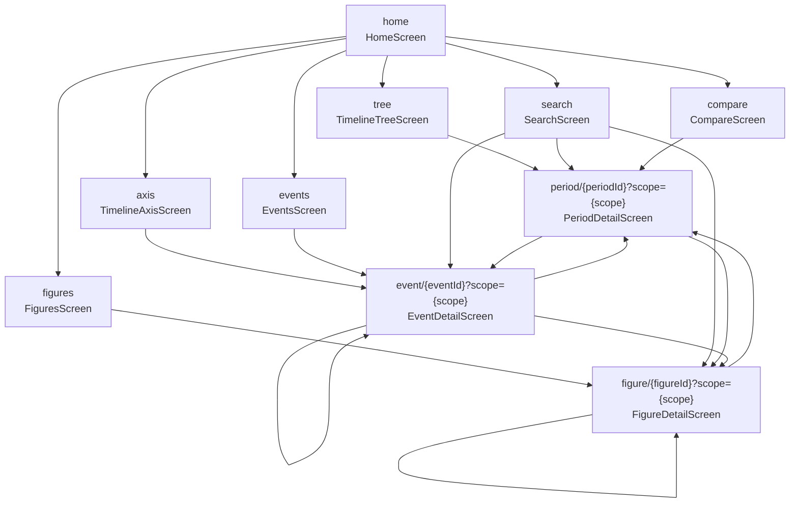

# 历史图鉴（History Atlas）产品与技术设计文档

> 文档版本：v1.0
> 编写日期：2026-11-10
> 适用代码版本：`versionName = 0.1.0` / `versionCode = 1`（`history-atlas/app/build.gradle.kts`）
> 依据源码：`data/SCHEMA.md`（数据契约 v1）、`docs/UI_SPEC.md`（界面规格）、`history-atlas/app/src/main/java/com/historyatlas/app/**`
>
> **本文档描述的是"代码现状 + 已确认的产品规划"**。凡标注「已实现」者，均可在上述源码路径中定位到具体类与函数；标注「规划中」者为尚未落地的设计承诺，不得在对外宣传中混同。

---

## 目录

1. [产品概述](#1-产品概述)
2. [核心功能矩阵](#2-核心功能矩阵)
3. [信息架构与导航](#3-信息架构与导航)
4. [数据模型](#4-数据模型)
5. [年表可视化方案](#5-年表可视化方案)
6. [内容生产与校对流程](#6-内容生产与校对流程)
7. [扩展路线图](#7-扩展路线图)
8. [技术架构](#8-技术架构)
9. [隐私、合规与版权](#9-隐私合规与版权)
10. [风险登记册](#10-风险登记册)
11. [附录](#11-附录)

---

## 1. 产品概述

### 1.1 一句话定位

**历史图鉴**是一款把"静态年表图"变成"可触摸的知识图谱"的纯离线 Android 应用：用马卡龙色块还原课本上的中国史 / 世界史年表树，让每一个朝代色块都能点开成一篇可读可搜的史文。

> 副标题（已上线文案）：**"看得见的年表，点得开的细节"** —— `ui/screens/HomeScreen.kt:88`

### 1.2 解决什么问题

现有历史类应用与静态年表图存在四类结构性缺陷：

| 痛点 | 静态年表图 | 通用百科 App | 历史图鉴的解法 |
|---|---|---|---|
| **只能看，不能钻** | 打印后即静态 | 搜索框跳转，丢失整体时空感 | 色块即入口：点「秦」直接进「秦」时期页，页内再下钻到子时期 / 事件 / 人物 |
| **缺乏时空对照** | 单条时间轴 | 各条目独立，看不出同时期 | 两条时间轴并排（中国史 / 世界史），共用一个"聚焦年代"游标 |
| **检索维度单一** | 纸质目录 | 关键词匹配，跨类别混排 | 三段式检索（时期 / 事件 / 人物），命中关键词在标题与摘要中**高亮**（`CommonComponents.kt:348` `buildHighlighted`） |
| **离线不可用** | 需要书 | 需要网络 | APK 内置 JSON，**不申请任何网络权限**（`AndroidManifest.xml` 中无 `INTERNET` 声明） |

一句话概括产品价值：**把"知道朝代顺序"升级为"理解朝代与事件、人物、同时期世界的因果与并发关系"。**

### 1.3 目标用户分层

| 用户层 | 典型场景 | 核心诉求 | 主用入口 | 关键指标（成功标准） |
|---|---|---|---|---|
| **中学生（备考）** | 复习历史课本、梳理时序、背诵大事年表 | 一眼看懂"朝代顺序 + 大事件锚点"；能按题型自测 | 年表总览 → 事件详情 → 搜索 | 单次会话内从年表树定位到目标事件 ≤ 3 次点击 |
| **大学生（备考 / 通识）** | 考研历史、跨文明比较、课程论文素材 | 事件细节与人物生平要"够读"；能查同期世界在发生什么 | 时间轴 → 事件详情 → 中外对照 | 事件详情正文可读长度 ≥ 150 字；对照页能定位到同期事件 |
| **亲子教育** | 家长与孩子共读，讲解某朝代 | 界面友好、无广告、无外链跳转、不诱导消费 | 年表总览 → 人物志 | 无任何跳转出 App 的外链；无购买/登录墙 |
| **历史爱好者** | 检索某个冷门人物 / 事件 / 争议条目 | 检索要快、要全、要能看长文 | 搜索 → 人物详情 / 事件详情 | 搜索结果三段均可见；人物详情展示生平 + 成就 + 名言 |
| **教师备课** | 快速找到某个时段的教案素材 | 按时期聚合事件与人物；能导出 | 时期详情 → 代表事件列表 | 时期详情一次呈现该时期全部子树事件（`eventsOfSubtree`） |

> 注：教师"导出/投屏"能力目前**未实现**，属 V1.1 之后的内容需求（见 §7）。

### 1.4 与现有产品的差异点

产品差异化可以概括为四个"可"：

1. **可交互的年表树** —— 不是把年表图贴进图片控件，而是用 Compose 组件实时布局：`PeriodBlock`（子时期色块）+ `EraSpineBlock`（时代脊柱块）+ `SpineConnector`（连接线）三层结构，数据变了布局立刻重排。
2. **可下钻的实体关系** —— 时期 → 子时期 → 事件 → 人物 → 相关事件，形成**有向环**：`period.relatedEvents` ↔ `event.figures` ↔ `figure.relatedEvents`，任何节点都能双向跳转。
3. **可搜索的跨实体索引** —— `HistoryRepository.search()` 在同一个 scope 内同时扫描 periods / events / figures 三类实体的 `name` / `alias` / `summary` / `tags` / `detail` / `biography` / `location` / `role` / `lifeText` / 日期文本，共 21 个匹配面（`HistoryRepository.kt:233-264`）。
4. **可对照的跨文明视图** —— `CompareScreen` 通过**年份区间相交**判定同期，不依赖任何额外数据字段，因此"同期"关系永远与数据保持一致，不会因为内容更新而失配。

---

## 2. 核心功能矩阵

状态口径：
- **已实现**：源码中存在对应实现且逻辑完整。
- **部分实现**：主路径可用，但规格中的部分交互（长按菜单、内联搜索框、年代滑块等）未落地。
- **规划中**：仅在本文档的路线图中承诺，代码中不存在。

| # | 功能 | 描述 | 优先级 | 实现状态 | 代码位置 / 说明 |
|---|---|---|---|---|---|
| F01 | **分支切换** | 首页分段控件在「中国史 / 世界史」之间切换，切换时预加载对应数据集 | P0 | **已实现** | `HomeScreen.kt:169` `ScopeSwitcher`；`MainViewModel.setScope()` → `repository.preload(scope)` |
| F02 | **年表总览树** | 三列分块年表：时代脊柱 / 子时期 / 三级时期，按持续年数映射色块高度 | P0 | **已实现** | `TimelineTreeScreen.kt` + `PeriodBlock.kt` `PeriodGroup` |
| F03 | **年表树搜索高亮** | 树页顶部内联搜索框，输入即高亮命中色块 | P1 | **部分实现** | `TimelineTreeScreen.kt:83-90` 有 `query`/`highlightIds` 状态，但**顶栏无输入框**（只有跳转搜索页的图标按钮），当前不可输入 |
| F04 | **年表树年代区间过滤** | 拖动年代滑块过滤出指定区间的时期 | P2 | **规划中** | `UI_SPEC.md §2.1` 提及，代码中无此控件 |
| F05 | **年表树长按菜单** | 长按色块弹出「查看关联事件 / 加入对比 / 复制年代」 | P2 | **规划中** | `PeriodBlock` 仅实现 `clickable`，无 `combinedClickable` |
| F06 | **时间轴（横向缩放）** | Canvas 绘制的横向时间轴，捏合缩放 + 拖动平移，公元前区域着色 | P0 | **已实现** | `TimelineAxis.kt` `TimelineAxis` Composable，`detectTransformGestures` |
| F07 | **时间轴刻度自适应** | 刻度间隔按当前缩放级别在 12 档候选中选取，保证间距 ≥ 60px | P0 | **已实现** | `TimelineAxis.kt:61` `TickIntervals` + `:111-113` |
| F08 | **时间轴事件分级标记** | 按 `importance` 1–5 分级绘制圆点半径；跨年事件画横条 | P0 | **已实现** | `TimelineAxis.kt:213-219` 半径 `6.5/5.2/4.2/3.4/2.8` |
| F09 | **时间轴分类筛选** | 顶部芯片行多选分类 | P0 | **已实现** | `TimelineAxisScreen.kt:109-121` `FilterChip` |
| F10 | **时间轴事件标签浮层** | importance=5 的标记带文字标签 | P1 | **部分实现** | 选中事件后显示 `EventAxisChip`（`TimelineAxisScreen.kt:135-143`），但**未按 importance=5 自动常驻显示标签** |
| F11 | **时期详情** | Banner + 概况（疆域/都城/人口/文化）+ 概述 + 标签 + 子时期 + 关键人物 + 代表事件 | P0 | **已实现** | `PeriodDetailScreen.kt` |
| F12 | **时期详情·同期世界** | 世界史时期页展示同时期中国节点（按年份区间匹配，无需额外字段） | P1 | **规划中** | `UI_SPEC.md §2.3` 提及，`PeriodDetailScreen` 中**无此区块** |
| F13 | **事件详情** | 分类徽章 + 星级 + 地点 + 标题 + 所属时期 + 摘要 + 可折叠正文 + 涉及人物 + 相关事件 + 标签 | P0 | **已实现** | `EventDetailScreen.kt`；正文超 220 字折叠（`:101-102`） |
| F14 | **事件详情·相关事件算法** | 同 `periodId` 且同 `category`，或共享人物，取前 8 条去重 | P0 | **已实现** | `EventDetailScreen.kt:90-97` |
| F15 | **人物详情** | 头像 + 姓名 + 别名 + 生卒 + 身份 + 所属时期 + 简介 + 生平 + 成就 + 名言 + 相关事件 + 相关人物 | P0 | **已实现** | `FigureDetailScreen.kt` |
| F16 | **搜索** | 实时过滤，三段结果（时期/事件/人物），命中词高亮，空态给出常用词 | P0 | **已实现** | `SearchScreen.kt`；空态提示词「秦 / 三国 / 丝绸之路 / 李白 / 工业革命」 |
| F17 | **人物志** | 按身份筛选 + 按顶层时期筛选，按时期分组展示 | P0 | **已实现** | `FiguresScreen.kt`；筛选 chip 上限：时期 14 个、身份 30 个 |
| F18 | **事件流** | 按时间倒序 + 分类筛选 + 「重要事件」快捷筛选（importance ≥ 4） | P0 | **已实现** | `EventsScreen.kt:64-69` |
| F19 | **中外对照** | 双列并排 + 聚焦年代游标，命中年代的时期高亮并展开摘要 | P0 | **已实现** | `CompareScreen.kt`；预设年代 `-2000/-500/0/200/500/1000/1400/1800/1949/2020` |
| F20 | **离线数据加载** | 从 assets 读取 `data/china.json` / `data/world.json`，懒加载 + 单次解析 + 索引 | P0 | **已实现** | `HistoryRepository.kt:45-67` |
| F21 | **悬空引用容错** | 清洗阶段剔除无效引用；事件/人物 periodId 悬空则整体丢弃 | P0 | **已实现** | `HistoryRepository.ScopeIndex.build()` 第 2–4 步 |
| F22 | **构建期数据同步** | `preBuild` 自动触发 `syncData`，把仓库根 `data/*.json` 复制进 assets | P0 | **已实现** | `build.gradle.kts:88-120` |
| F23 | **收藏 / 笔记** | 用户标记时期 / 事件 / 人物并写笔记 | P1 | **规划中** | V1.1 |
| F24 | **横向年表视图** | 把树形年表改为可横向滚动的宽版布局 | P1 | **规划中** | V1.1 |
| F25 | **离线数据热更新** | 不重新发版即可替换本地数据集 | P1 | **规划中** | V1.1 |
| F26 | **学习模式（题库 / 闯关 / 错题本）** | 按朝代或分类生成选择题，答题闯关，错题本 | P2 | **规划中** | V1.2 |
| F27 | **多文明对比视图** | 用户自选任意两个文明/时期做对照，不限于中国 vs 世界 | P2 | **规划中** | V2.0 |
| F28 | **地图视图** | 事件按地理位置落点在地图上展示 | P2 | **规划中** | V2.0 |
| F29 | **因果关系图谱** | 事件之间建立因果边，绘制有向图 | P2 | **规划中** | V2.0 |
| F30 | **跨设备同步** | 收藏 / 笔记 / 学习进度跨端同步 | P2 | **规划中** | V2.0（需引入网络权限，与当前"无网络"定位冲突，见 §9） |
| F31 | **暗色主题** | 深色模式下完整适配 | P2 | **部分实现** | `Theme.kt` 定义了 `DarkColors` 与 `AtlasExtraColors` 深色值，但**色块 `AtlasColorMap` 与 `AxisCategoryColors` 全为浅色调和值，未做深色适配** |

### 2.1 功能状态汇总

```
已实现      F01 F02 F06 F07 F08 F09 F11 F13 F14 F15 F16 F17 F18 F19 F20 F21 F22   (17)
部分实现    F03 F10 F31                                                        ( 3)
规划中      F04 F05 F12 F23 F24 F25 F26 F27 F28 F29 F30                       (11)
```

**结论：核心浏览、检索、对照链路已闭环（P0 全部落地）；差距集中在"用户生成内容"与"高级对照"两类，恰好构成 V1.1 / V1.2 / V2.0 的路线。**

---

## 3. 信息架构与导航

### 3.1 完整导航图

路由定义于 `ui/AppNavHost.kt` 的 `Routes` 对象，全部为 **Compose Navigation** 路由。



### 3.2 路由参数表

| 常量 | 路由模板 | 参数 | 默认值 | 说明 |
|---|---|---|---|---|
| `HOME` | `home` | — | — | 启动页，`startDestination` |
| `TREE` | `tree` | — | — | 年表总览 |
| `AXIS` | `axis` | — | — | 时间轴 |
| `FIGURES` | `figures` | — | — | 人物志 |
| `EVENTS` | `events` | — | — | 事件流 |
| `SEARCH` | `search` | — | — | 搜索 |
| `COMPARE` | `compare` | — | — | 中外对照 |
| `PERIOD` | `period/{periodId}?scope={scope}` | `periodId`: StringType<br/>`scope`: StringType | `scope` = `china` | 时期详情 |
| `EVENT` | `event/{eventId}?scope={scope}` | `eventId`: StringType<br/>`scope`: StringType | `scope` = `china` | 事件详情 |
| `FIGURE` | `figure/{figureId}?scope={scope}` | `figureId`: StringType<br/>`scope`: StringType | `scope` = `china` | 人物详情 |

**关键设计：`scope` 走 query 参数而非 path。** 理由：三个详情页的界面结构在两个 scope 下完全一致，只是数据源不同。若按 scope 拆成两套路由，会产生 6 个详情页并让跳转逻辑分叉。现在只有 3 个详情页 + 1 个 query 参数。构造 helper：

```kotlin
fun period(id: String, scope: String) = "period/$id?scope=$scope"
fun event(id: String, scope: String) = "event/$id?scope=$scope"
fun figure(id: String, scope: String) = "figure/$id?scope=$scope"
```

### 3.3 scope 的三重载体

`scope`（中国史 / 世界史）在代码中有三个并行载体，需要理解它们的分工：

| 载体 | 类型 | 生命周期 | 作用 |
|---|---|---|---|
| `MainViewModel.uiState.scope` | `StateFlow<String>` | Activity 生命周期 | **真相源**。首页分段控件的选中态 |
| `AppNavHost(scope = ...)` 参数 | `String` | 每次重组 | 传递给**列表类**页面（tree / axis / figures / events / search），这些页面位于导航栈顶层，切 scope 后立即反映 |
| 路由 query `?scope=` | `String` | 导航条目 | 传递给**详情类**页面。详情页从 `entry.arguments` 读取，形成**快照语义** |

> **为什么要两份？** 详情页可能在用户切换 scope 之前就已入栈。若详情页也订阅全局 scope，用户在详情页停留时切到另一分支，页面内容会突变（当前实体在新分支里可能根本不存在）。用 query 参数做快照，详情页内容在其生命周期内保持稳定，同时顶栏仍能显示"属于中国史"。
>
> 注意 `AppNavHost.kt:53` 定义了 `LocalScope = compositionLocalOf { SCOPE_CHINA }`，但**当前代码中没有任何 Composable 消费它**——这是一处预留但未接线的扩展点。

### 3.4 各页面职责与关键交互

#### 3.4.1 HomeScreen（首页）

**职责**：分支切换 + 六大功能入口 + 数据规模概览。

| 区块 | 内容 | 交互 |
|---|---|---|
| 标题区 | "历史图鉴" + "看得见的年表，点得开的细节" | 无 |
| `ScopeSwitcher` | 两段式控件，容器底色 `#EDE8DE`，选中项白底 | 点击切换 `onScopeChange` |
| `SearchEntry` | 搜索图标 + 占位文案"搜索朝代、事件、人物…" | 整条可点 → `search` |
| 统计卡 | 时期 / 事件 / 人物 三个数字格 | 无 |
| 五个入口卡 | 年表总览、时间轴、人物志、事件流、中外对照 | 各带 `Icons.Outlined.*` 与主题色块 |

关键实现细节：

- 统计数字用 `remember(scope) { repository.statistics(scope) }` 缓存，切 scope 时重算。
- 五个入口卡的图标底色分别取自 `colorFor("han")` / `colorFor("sui-tang")` / `colorFor("greece")` / `colorFor("rome")` / `colorFor("purple")`，与数据里的朝代色键呼应。

#### 3.4.2 TimelineTreeScreen（年表总览）

**职责**：复刻参考图的"分块年表树"，是 App 的第一视觉名片。

**数据准备**（全部 `remember(scope)` 缓存）：

```kotlin
val eras          = repository.topLevelPeriods(scope)                    // 顶层时期
val childrenMap   = eras.associate { it.id to repository.childrenOf(it.id, scope) }
val grandChildrenMap = childrenMap.values.flatten()
                        .associate { it.id to repository.childrenOf(it.id, scope) }
val maxSpan       = repository.periods(scope).maxOfOrNull { endYear - startYear } ?: 1
```

**渲染结构**：外层 `LazyColumn`（`key = { it.id }`），每项一个 `PeriodGroup`。`PeriodGroup` 内部为 `Row`：

```
Row
├── EraSpineBlock        (78dp 宽)  时代块：竖排折行名称 + 起止年
├── Spacer(8dp)
├── SpineConnector       (26dp 宽)  竖线 1.5dp (#CFC6B8) + 中点横杠 + 年份标签
├── Spacer(4dp)
└── Column(weight=1f)               子时期列
    ├── PeriodBlock      子时期色块
    │   └── Column(start=16dp, spacedBy=3dp)   三级时期色块（缩进嵌套）
    ├── PeriodBlock
    └── ...
```

**关键交互**：点击任意色块 → `onPeriodClick` → 导航至 `period/{id}?scope={scope}`。**无长按菜单、无年代滑块**（见 F04/F05）。

**空态**：`eras.isEmpty()` 时显示 `EmptyHint("内容数据未就绪，请稍后重试")`，不崩溃。

#### 3.4.3 TimelineAxisScreen（时间轴）

**职责**：以连续时间刻度呈现全部事件，提供分类筛选与事件快速定位。

**布局**：`Column` 自上而下 —— 分类 chip 行 → `TimelineAxis`（高 280dp）→ 选中事件预览条 → "事件流" `SectionHeader` → `LazyColumn` 事件列表。

**关键交互**：

| 交互 | 实现 | 细节 |
|---|---|---|
| 分类多选 | `FilterChip` 集合，`selectedCategories` 为 `Set<EventCategory>` | 默认全选；`EventCategory` 按 `ordinal` 排序展示 |
| 捏合缩放 | `detectTransformGestures` 的 `zoom` | `pixelsPerYear` 夹在 `[0.0008f, 40f]` |
| 拖动平移 | 同上的 `pan` | `centerYear += pan.x / pixelsPerYear` |
| 点击标记 | `detectTapGestures` | 找 x 距离最近的标记，**距离 < 36f 才触发**，避免误触 |
| 选中预览 | `selectedEventId` 状态 | 显示 `EventAxisChip`（色点 + 名称 + 日期·分类），点击进入事件详情 |

**列表截断**：`filtered.take(400)`。若事件总数超过 400，超出部分在时间轴页不可见（可通过"事件流"页查看全部）——这是一个已知限制，见 §10 风险 R07。

#### 3.4.4 PeriodDetailScreen（时期详情）

**职责**：一个时期的完整档案。

区块顺序与数据来源：

| # | 区块 | 数据字段 | 条件 |
|---|---|---|---|
| 1 | Banner（色块底 + 别名 + 名称 + 年份区间） | `colorKey` / `alias` / `name` / `yearRangeText` | 总是 |
| 2 | 概况卡（疆域 / 都城 / 人口 / 文化） | `territory` / `capital` / `population` / `culture` | 总是；`InfoRow` 遇空值自动跳过 |
| 3 | 概述 | `summary` | `summary.isNotBlank()` |
| 4 | 标签 | `tags` | 最多 8 个 |
| 5 | 子时期横滑卡 | `childrenOf(periodId)` | 非空 |
| 6 | 关键人物横排 | `resolveFigureIds(keyFigures)` | 非空 |
| 7 | 代表事件列表 | `eventsOfSubtree(periodId)` | 最多 300 条 |

**关键点**：`eventsOfSubtree()` 递归收集该时期**及其全部后代**的事件并按 `year` 排序，因此"秦"页会同时列出秦朝、秦的子时期里的事件。

**缺失态**：id 不存在时顶栏显示"时期不存在" + `EmptyHint("未找到该时期")`。

#### 3.4.5 EventDetailScreen（事件详情）

| # | 区块 | 说明 |
|---|---|---|
| 1 | 元信息条 | `CategoryBadge` + `ImportanceStars`（5 颗，非 compact）+ 地点图标与文字 |
| 2 | 大标题 | `event.name`，22sp Bold |
| 3 | 所属时期条 | 可点击 → 时期详情；显示时期名 + 年份区间 |
| 4 | 摘要卡 | `event.summary` |
| 5 | 详细记述 | `event.detail`，超 220 字折叠，"展开全文 / 收起"切换 |
| 6 | 涉及人物 | `LazyRow` 圆形头像横排，点击进人物详情 |
| 7 | 相关事件 | 同时期同分类 + 共享人物，去重后取前 8 |
| 8 | 标签 | 最多 10 个 |

#### 3.4.6 FigureDetailScreen（人物详情）

| # | 区块 | 说明 |
|---|---|---|
| 1 | 头像区 | `FigureAvatar`（92dp）+ 姓名 24sp + 别名 + `MetaPill(lifeText 或 "生卒不详")` + `MetaPill(role)` + 所属时期（可点） |
| 2 | 简介 | `summary` |
| 3 | 生平 | `biography`，行高 25sp |
| 4 | 主要成就 | 圆点 + 文本列表 |
| 5 | 名言 | `QuoteCard`（左侧 3dp 竖线 #C9B896 + 引号文本 + 署名） |
| 6 | 相关事件 | `resolveEventIds(relatedEvents)` |
| 7 | 相关人物 | `LazyRow` 头像网格 |

#### 3.4.7 SearchScreen（搜索）

- 顶栏内嵌 `OutlinedTextField`，`singleLine = true`，IME Action 为 Search（触发时收起键盘）。
- 有清空按钮（`Icons.Outlined.Close`，仅 `query.isNotEmpty()` 时显示）。
- 结果分三段：`SectionHeader("时期", trailing="N 个")` / `"事件"` / `"人物"`。
- **截断**：时期 30 条、事件 60 条、人物 60 条。`SectionHeader` 的 trailing 显示的是**真实总数**，用户能看到"共 120 条"但只列出 60 条 —— 需在 V1.1 补一个"加载更多"。
- 空态：`query` 为空 → 5 个常用词提示按钮（秦 / 三国 / 丝绸之路 / 李白 / 工业革命）；有查询无结果 → `EmptyHint("没有找到「$query」相关内容")`。

#### 3.4.8 FiguresScreen（人物志）

- 两行 chip：`全部时期` + 顶层时期（≤14 个）；`全部身份` + 身份列表（≤30 个）。
- 筛选逻辑：身份**精确等于** `figure.role`（非模糊），时期**精确等于** `figure.periodId`（仅顶层 id，因此选中"汉"不会列出挂在"西汉"下的人物 —— 这是已知语义瑕疵，见 §10 风险 R09）。
- 分组：`groupBy { periodId }` → 按时期 `startYear` 排序 → 每组一个 `SectionHeader`（含时期名 + 人数 + 年份区间）。

#### 3.4.9 EventsScreen（事件流）

- 筛选 chip 行：`重要事件`（`importance >= 4`）+ 全部分类。
- 排序：`sortedByDescending { it.year }`（时间倒序，最新在前）。
- **无分页**：全部结果一次性交给 `LazyColumn`，由 LazyColumn 虚拟化承担性能。

#### 3.4.10 CompareScreen（中外对照）

**职责**：中国史与世界史的同期并排对照。

**交互模型**：

```
focusYear (默认 1400)
    │
    ├── 中国史列：periods 满足 focusYear ∈ [startYear, endYear] → 高亮 + 展开摘要
    └── 世界史列：同上
```

- 年代选择用 **10 个预设按钮**（`-2000 / -500 / 0 / 200 / 500 / 1000 / 1400 / 1800 / 1949 / 2020`）而非连续 `Slider`，因为跨越公元前后的整段区间用滑块难以精确落点；按钮标签做了取整（`前2000` / `1400`）。
- 命中判定：`focusYear in period.startYear..period.endYear`，**纯数值区间相交**，不依赖任何数据字段。
- 命中卡片背景换成该时期的 `colors.block`，并追加 1.5dp `colors.accent` 描边。

### 3.5 全局返回行为

| 页面 | 返回按钮 | 实现 |
|---|---|---|
| 详情页（period/event/figure） | `DetailTopBar` 的 `IconButton` | `navController.popBackStack()` |
| 年表总览 | `TopAppBar.navigationIcon` | **空实现**（`TimelineTreeScreen.kt:112` `IconButton(onClick = { /* 由 NavHost 托管返回 */ })`），点返回无反应 —— 依赖系统返回键 |
| 时间轴 / 人物志 / 事件流 / 搜索 / 对照 | 无 `navigationIcon` | 依赖系统返回键 |

> 系统返回键在 `NavHost` 上正常工作（Compose Navigation 默认接管 `OnBackPressedDispatcher`）。

---

## 4. 数据模型

### 4.1 三实体总览

数据契约定义在 `data/SCHEMA.md` v1，App 侧的 Kotlin 映射在 `app/src/main/java/com/historyatlas/app/data/Models.kt`。

```json
{
  "version": 1,
  "scope": "china",
  "periods": [ ... ],
  "events":  [ ... ],
  "figures": [ ... ]
}
```

| 实体 | Kotlin 类 | 语义 | 关键字段 |
|---|---|---|---|
| `periods[]` | `Period` | 时期（朝代）节点，构成主年表树 | `id` `name` `parentId` `startYear` `endYear` `colorKey` `summary` `territory` `capital` `population` `culture` `keyFigures[]` `relatedEvents[]` `tags[]` |
| `events[]` | `Event` | 历史事件，挂在时期下 | `id` `name` `year` `yearEnd` `dateText` `periodId` `category` `location` `summary` `detail` `importance` `figures[]` `tags[]` |
| `figures[]` | `Figure` | 人物，挂在时期下 | `id` `name` `alias` `birthYear` `deathYear` `lifeText` `role` `periodId` `gender` `summary` `biography` `achievements[]` `quotes[]` `relatedEvents[]` `relatedFigures[]` `tags[]` |

### 4.2 单向引用设计与悬空引用容错

#### 4.2.1 引用图

契约明确"三个数组通过 id 互相引用（单向引用，避免循环结构）"。实际引用关系：

```
period.parentId      ──→ period.id        （树形，天然无环）
period.keyFigures[]  ──→ figure.id        （可选列表）
period.relatedEvents[] ─→ event.id        （可选列表）
event.periodId       ──→ period.id        （必填）
event.figures[]      ──→ figure.id        （可选列表）
figure.periodId      ──→ period.id        （必填）
figure.relatedEvents[] ─→ event.id        （可选列表）
figure.relatedFigures[] → figure.id       （可选列表）
```

**"单向"指的是数据文件中的存储形态**：没有把子节点数组嵌在父节点里（否则 JSON 会出现嵌套或双向冗余），只存 id 字符串。这样：

- 同一实体只需存储一份，改名 / 改内容不需要同步多处。
- 文件是扁平的，易于用脚本分块生成与合并（见 `data/.tmp/figs_b01.py` 的批次模式）。
- 引用关系由 `ScopeIndex.build()` 在运行时统一解析为对象图。

#### 4.2.2 容错策略（`ScopeIndex.build()`）

容错发生在**数据层清洗阶段**，而非 UI 层。这样 UI 永远不需要判断"这个 id 是不是坏的"。

| 引用类型 | 悬空时的处理 | 代码位置 |
|---|---|---|
| `period.parentId` | **降级为顶层**（`parentId = null`），不丢弃该时期 | `:276-289` |
| `period.parentId == self` | 自引用 → 置 null（防环） | `:279` |
| `period.keyFigures[]` | **剔除该条目**，其余保留 | `:286` |
| `period.relatedEvents[]` | **剔除该条目**，其余保留 | `:287` |
| `event.periodId` | **整个事件丢弃**（契约要求 periodId 必须存在，事件无处安放） | `:293-295` |
| `event.figures[]` | **剔除该条目** | `:296` |
| `figure.periodId` | **整个人物丢弃** | `:300-301` |
| `figure.relatedEvents[]` / `relatedFigures[]` | **剔除该条目** | `:304-305` |

**去重**：`periodById` / `eventById` / `figureById` 用 `LinkedHashMap` + `putIfAbsent`，保留首次出现。

**为什么"事件因 periodId 悬空而整体丢弃"是对的？** 事件是"发生在某时期的事"，脱离时期就失去了语境；而时期的 `parentId` 悬空只影响树的层级，不影响该时期本身的语义，所以降级为顶层更保守、更无损。这是一个**按引用语义区分严重级别**的设计。

**为什么"列表型引用只剔除不整体丢弃"？** `keyFigures` 少一个只是头像少一个，不影响时期页面的其他内容。

#### 4.2.3 UI 层的最后一道防线

即使数据层已经清洗，详情页仍处理"id 查不到"的情况：

```kotlin
val period = remember(periodId, scope) { repository.period(periodId, scope) }
if (period == null) {
    Scaffold(topBar = { DetailTopBar("时期不存在", onBack) }) { /* EmptyHint("未找到该时期") */ }
    return
}
```

事件详情、人物详情同理（"事件不存在" / "人物不存在"）。三层防护：**清洗剔除 → 查询返回 null → 页面空态**。

### 4.3 id 命名规范

```
<scope>-<语义前缀>-<短标识>
```

| 规则 | 说明 | 示例 |
|---|---|---|
| 全局唯一 | 跨 `periods` / `events` / `figures` 三个数组唯一 | `cn-qin` 与 `fig-qin-shi-huang` 不冲突 |
| ASCII 小写中划线 | 不含中文、不含下划线、不含大写 | `cn-han-west` ✅ `cn_HanWest` ❌ |
| scope 前缀 | 中国史 `cn-`，世界史 `w-` | `cn-han` / `w-rome` |
| 实体前缀 | 事件 `ev-`，人物 `fig-` | `ev-qin-unify` / `fig-li-si` |
| 语义可读 | 用拼音或英文单词，不使用无意义编号 | `cn-wudai-north` ✅ `cn-p-014` ❌ |

**已落地实例**（来自 `data/.tmp/periods_data.py` 与 `world_periods.json`）：

```
时期：cn-prehistory  cn-xia-shang  cn-zhou  cn-han-west  cn-three-kingdoms
      cn-tang-mid    cn-song-north  cn-ming-late  cn-prc-reform
      w-prehistory   w-old-babylon  w-ancient-near-east  w-near-east-persian
人物：fig-qin-shi-huang  fig-li-si  fig-peking-man  fig-hammurabi
```

### 4.4 `category` 事件分类枚举（20 值）

契约 §5 与 `Models.kt` 的 `EventCategory` 枚举一一对应。App 侧为每个分类维护了**徽章配色**（`CommonComponents.kt:54` `CategoryColors`）与**时间轴标记配色**（`TimelineAxis.kt:64` `AxisCategoryColors`）。

| 值 | 中文 | 徽章底 / 文字 | 时间轴标记色 |
|---|---|---|---|
| `political` | 政治 | `#E3EAF6` / `#3A5F9E` | `#3A5F9E` |
| `military` | 军事 | `#F7DEDE` / `#A85252` | `#A85252` |
| `economic` | 经济 | `#F6ECD8` / `#8F6A20` | `#8F6A20` |
| `cultural` | 文化 | `#EDE3F3` / `#7A4C8C` | `#7A4C8C` |
| `scientific` | 科技 | `#DDEFEF` / `#2F6F8F` | `#2F6F8F` |
| `social` | 社会 | `#E9E9E4` / `#6B6B5F` | `#6B6B5F` |
| `religious` | 宗教 | `#EDE6DA` / `#7A6247` | `#7A6247` |
| `art` | 艺术 | `#F9E7EF` / `#A85178` | `#A85178` |
| `literature` | 文学 | `#F1E6F2` / `#85558F` | `#85558F` |
| `education` | 教育 | `#E8EDE2` / `#5C7040` | `#5C7040` |
| `technology` | 技术 | `#DDEDEA` / `#2F6F6A` | `#2F6F6A` |
| `exploration` | 探索/地理 | `#E2EEE3` / `#44754A` | `#44754A` |
| `conflict` | 战争/冲突 | `#FAE3DC` / `#B05540` | `#B05540` |
| `treaty` | 条约/外交 | `#E4EAE6` / `#4C6B5C` | `#4C6B5C` |
| `reform` | 改革/变法 | `#EAE4F5` / `#61509B` | `#61509B` |
| `dynasty` | 王朝更替/建国 | `#F6E3E3` / `#9E4A4A` | `#9E4A4A` |
| `cross-civilization` | 跨文明交流 | `#F5EBD6` / `#946A22` | `#946A22` |
| `disaster` | 灾难/灾荒 | `#E8E3E0` / `#7D5C4E` | `#7D5C4E` |
| `health` | 医学/疾病 | `#DFEFEC` / `#357068` | `#357068` |
| `economy-crisis` | 经济危机 | `#F3E2D6` / `#9A5B33` | `#9A5B33` |

**未知分类的兜底**：`EventCategory.from(value)` 对未枚举值返回 `SOCIAL`（`Models.kt:148`），不抛异常。App 侧 `EventCategory.from()` 与 `AxisCategoryColors[cat]` 的双层兜底保证了渲染永不失败。

### 4.5 `colorKey` 配色枚举（23 值）

契约 §6 定义，App 侧由 `ColorKeys` 对象常量 + `AtlasColorMap` 映射表 + `colorFor()` 函数三层实现。

**中国史 14 键**：`stone`（石器/远古）、`cyan`（夏商）、`zhou`（西周/东周）、`blue`（秦）、`han`（汉）、`green`（三国两晋南北朝）、`sui-tang`（隋唐）、`yellow`（五代宋辽金）、`yuan`（元）、`pink`（明）、`qing`（清）、`gray`（民国/近代）、`modern`（现代）、`purple`（跨朝代/专题）

**世界史 9 键**：`prehistory`（史前）、`mesopotamia`（两河/埃及）、`india`（印度河）、`greece`（古希腊）、`rome`（古罗马）、`medieval`（中世纪）、`renaissance`（文艺复兴）、`earlymodern`（近代早期）、`contemporary`（当代）

**每个 colorKey 对应一组双色**（`AtlasColor`）：

| 语义 | 用途 | 举例 |
|---|---|---|
| `block` | 色块**底色**（浅） | `han` → `#E3DFF2`（浅紫） |
| `accent` | 文字 / 图标 / 描边**强调色**（深一档） | `han` → `#5C4E92`（深紫） |

设计意图：马卡龙底色必须足够浅才能承载多行文字，`accent` 则保证标题在浅底上仍有足够对比度。

**未知 colorKey 的哈希回退**（`Color.kt:120-129`）：

```kotlin
fun colorFor(colorKey: String, fallbackId: String = ""): AtlasColor {
    val key = colorKey.trim().lowercase()
    AtlasColorMap[key]?.let { return it }
    val source = fallbackId.ifEmpty { key }
    val hash = source.fold(0) { acc, ch -> (acc * 31 + ch.code) and 0x7FFFFFFF }
    return FallbackPalette[hash % FallbackPalette.size]
}
```

回退调色板 6 组柔和色（`#E7E3F0` / `#DFEBE0` / `#F3E6D8` / `#DDE9F0` / `#F2E1E6` / `#E9EDE0`），按 id 的 `acc*31 + code` 滚动哈希取模 —— **同一 id 永远得到同一颜色**，保证视觉稳定性。

### 4.6 年份表示：负数约定与双轨制

#### 4.6.1 负数表示约定

契约 §7.1：**公元前为负数，公元后为正数，不使用 0 年**。

```json
{ "startYear": -221, "endYear": -207, "startDateText": "公元前221年", "endDateText": "公元前207年" }
```

| 字段 | 语义 | 负值含义 |
|---|---|---|
| `period.startYear` / `endYear` | 时期起止 | 公元前 |
| `event.year` / `yearEnd` | 事件发生年 | 公元前 |
| `figure.birthYear` / `deathYear` | 生卒年 | 公元前（可为 `null` 表示不详） |

**为什么不用 0 年？** 历史上没有公元 0 年（从公元前 1 年直接到公元 1 年）。若用 0 表示公元 1 年前，跨越公元元的区间在数值上会出现"结束年 = 0"或"开始年 = 0"这类尴尬边界。用负数直连可以保证：

- 区间判定 `startYear <= endYear` 恒成立且无歧义。
- `focusYear in p.startYear..p.endYear` 在跨越公元时的时期（如 `cn-han-east` 25–220）上不会漏判公元前的那一段。
- 排序 `sortedBy { it.year }` 天然得到从古至今的顺序。

代价是**公元前与公元后之间存在"1 年"的数值断层**（公元前 1 年 = -1，公元 1 年 = 1，中间没有 0）。这个断层在时间轴上表现为公元零线两侧相邻，实际影响极小（视觉上 `yearToX(0)` 正好落在零线位置）。

#### 4.6.2 双轨制：数值 + 展示文本

契约 §7.2 明确"展示文本与数值并存"：

| 用途 | 字段 | 示例 |
|---|---|---|
| 计算（排序 / 区间 / 定位） | `startYear` / `endYear` / `year` / `yearEnd` / `birthYear` / `deathYear` | `-221` |
| 展示（UI 直接渲染） | `startDateText` / `endDateText` / `dateText` / `lifeText` | `"公元前221年"` |

**代码中的体现**：

- `Period.yearRangeText`（`Models.kt:52-58`）组合两个展示文本：`"$startDateText — $endDateText"`，带 em-dash 分隔。
- 时间轴的 `yearToX()` **只用数值**（`e.year.toFloat()`），绝不解析文本。
- 事件列表的年份列显示 `event.dateText`，且用 `ifBlank { "—" }` 兜底 —— **展示文本缺失时数值仍然可用于排序**，只是 UI 显示破折号。

**为什么不干脆让 App 自己格式化年份？** 因为史实中的日期远不止"某年"：可能有"公元前221年10月"（秦统一）、"公元105年"（蔡伦造纸）、"公元1644年"（清入关）。这些精度差异只有内容侧知道，App 强行格式化会把"公元前221年10月"截断成"公元前221年"，造成信息损失。契约把格式化权交给内容侧，是正确的分工。

**契约 §7.3 的配套要求**："未知信息用 `null` 或省略，不要编造具体数字（如人口估计用 `约3000万` 而非精确值）"。`population` 字段因此是**字符串**而非数字。

### 4.7 派生属性（Kotlin 计算属性）

契约没有的字段，App 在 Kotlin 侧派生：

| 属性 | 定义 | 用途 |
|---|---|---|
| `Period.yearRangeText` | `startDateText — endDateText` | 时期卡片 / 详情页 |
| `Event.span` | `(yearEnd ?: year) - year` | 事件跨度 |
| `Event.spanStart` / `spanEnd` | `year` / `yearEnd ?: year` | 时间轴色条绘制 |
| `SearchResult.isEmpty` / `.total` | 三类结果聚合判定 | 搜索页空态 |

---

## 5. 年表可视化方案

本章是两个核心可视化组件的设计与实现说明。

### 5.1 分块年表树布局算法

#### 5.1.1 视觉目标

参考图「中国历史（消歧义）」的核心观感：

- **三列结构**：左列是大时期（时代），中列是该时代的子时期，右列（缩进）是三级时期。
- **马卡龙色块**：每个时期一个柔和底色，块内深墨色文字。
- **脊柱连接**：左列块右侧一条贯穿竖线，暗示"时间连续"。
- **高度按持续年数变化**，但长时期不能无限膨胀、短时期不能被压扁。

#### 5.1.2 色块高度：平方根映射到 46–152dp

**核心公式**（`PeriodBlock.kt:61-67`）：

```kotlin
private val MinBlockHeight = 46.dp
private val MaxBlockHeight = 152.dp

private fun blockHeight(span: Int, maxSpan: Int): Dp {
    if (maxSpan <= 0) return MinBlockHeight
    val ratio = (sqrt(span.coerceAtLeast(1).toDouble()) / sqrt(maxSpan.toDouble())).toFloat()
    val minPx = MinBlockHeight.value      // 46.0
    val maxPx = MaxBlockHeight.value      // 152.0
    return (minPx + (maxPx - minPx) * ratio).coerceIn(minPx, maxPx).dp
}
```

即：

```
h(span) = 46 + (152 - 46) × √(span / maxSpan)
         = 46 + 106 × √(span) / √(maxSpan)
```

**为什么用平方根而不是线性？**

这是本章最需要解释清楚的一点。设 `maxSpan` 为该 scope 内所有时期的**最大跨度**，考虑三个具体数字（以中国史数据为例，`maxSpan` 取史前时期约 207 万年，此处以典型值演示）：

| 时期 | span（年） | 线性映射 `46 + 106×(span/maxSpan)` | 平方根映射 `46 + 106×√(span/maxSpan)` | 平方根实际高度（maxSpan = 4000 年时） |
|---|---|---|---|---|
| 秦 | 15 | 46.4 dp | 47.3 dp | 47.3 dp |
| 西汉 | 211 | 51.6 dp | 60.6 dp | 60.6 dp |
| 唐朝 | 289 | 53.7 dp | 68.2 dp | 68.2 dp |
| 清朝 | 268 | 53.1 dp | 66.8 dp | 66.8 dp |
| 汉（长时段） | 400 | 56.6 dp | 75.6 dp | 75.6 dp |
| 上限（maxSpan） | 4000 | 152 dp | 152 dp | 152 dp |

**线性映射的问题**：因为真实历史的最大跨度（史前时期百万年级）与最小跨度（秦 15 年）相差**五个数量级**，线性映射会把 99.99% 的时期压成几乎同样高的薄片。以 `maxSpan = 4000` 为例，秦只比最小高度高 0.4dp —— 视觉上就是一条线，标题文字（14sp 粗体 + 2 行年份，共需 ~44dp）根本放不下。

**平方根映射的三个好处**：

1. **压缩极端值**：对 span 取平方根，等于把"数量级差异"降为"倍数差异"。`√15 ≈ 3.9`，`√4000 ≈ 63`，比值从 267 降到 16.2。短时期因此能拿到 47dp 以上的空间，足够渲染标题 + 起始年 + 结束年三行文字（`PeriodBlock` 的内边距为 `vertical = 6dp`，`Text` 行高 18sp + 13sp×2 + 2dp 间距 ≈ 52dp，因此最小值 46dp 是**略偏紧但可接受**的下限）。

2. **保留相对差异**：平方根是单调函数，短时期之间、同时期之间的相对大小关系仍被保留 —— 秦（15 年）依然明显矮于唐（289 年），读者仍能"看出长短"。只是差距从 7.3dp 放大到 20.9dp，更可读。

3. **上界仍有意义**：`maxSpan` 归一化保证最长时期拿到 152dp 的完整色块，不会因内容更新（比如新增一个十万年的时期）而使所有块都被压扁。

**为什么还需要 `.coerceIn(minPx, maxPx)`？** 双重保险：`ratio` 数学上必在 `[0,1]`（`sqrt` 单调且 `span ≤ maxSpan`），但 `coerceIn` 防止浮点误差导致越界，也让未来若改为其他映射方式时行为可预期。

**`span.coerceAtLeast(1)` 的作用**：若某个时期 `endYear == startYear`（单点时期），`sqrt(0) = 0` 会给出 46dp 的最小块，虽然不是 0，但为避免极端值，统一按 1 年处理，比例失真可忽略。

**`maxSpan` 的作用域**：是**整个 scope 内**的最大跨度，而非单个时代内。这样"秦"（15 年）和"史前"（207 万年）在同一张图里高度比约为 `√(15/2070000) ≈ 0.0027`，几乎不可见 —— 这是当前实现的一个已知局限（见 §10 风险 R06 与 §5.1.6 的改进方向）。

#### 5.1.3 三列结构与脊柱连接线

**列宽分配**（`PeriodBlock.kt` 与 `PeriodGroup`）：

| 列 | 组件 | 宽度 | 内容 |
|---|---|---|---|
| 1 | `EraSpineBlock` | `78.dp`（固定） | 时代名（13sp Bold，居中，最多 3 行）+ 起始年（9sp）+ 结束年（9sp） |
| — | `Spacer` | `8.dp` | 列间距 |
| 2 | `SpineConnector` | `26.dp`（固定） | 竖线 + 中点横杠 + 标签 |
| — | `Spacer` | `4.dp` | 列间距 |
| 3 | `Column(weight = 1f)` | 剩余空间 | 子时期色块；每个子时期下缩进 16dp 放三级色块 |

**时代块的两处细节**：

1. **年份去"公元"前缀**：`period.startDateText.replace("公元", "")` —— 这样"公元前221年"变成"公元前221年"（不变），"公元1644年"变成"1644年"，节省横向空间且与 `EraSpineBlock` 的 78dp 宽度匹配。
2. **高度下限**：`heightIn(min = 56.dp)` —— 时代块至少能容纳三行文字，不因名称短而塌陷。

**脊柱连接线的绘制**（`SpineConnector`，`PeriodBlock.kt:189-226`）：

```
Box(width = 26dp, height = <该时代所有子块总高>)
├── Box(width = 1.5dp, fillMaxHeight, bg #CFC6B8)   ← 竖线，align(TopCenter)
└── Column(align = Center)
    ├── Box(width = 14dp, height = 1.5dp, bg #CFC6B8)  ← 中点横杠
    └── Text(label, 9sp, InkTertiary)                    ← 年份标签
```

**连接线高度的计算**（`PeriodGroup` 第 266-271 行）：

```kotlin
val childrenHeight = children.sumOf {
    blockHeight((it.endYear - it.startYear).coerceAtLeast(0), maxSpan).value.toDouble()
}.toFloat()
SpineConnector(
    height = (childrenHeight + (children.size - 1).coerceAtLeast(0) * 4f).dp,
    label = era.startDateText.replace("公元", ""),
)
```

即：**竖线高度 = 子块高度之和 + (子块数 - 1) × 4dp 间距**。4dp 正是 `Column(verticalArrangement = Arrangement.spacedBy(4.dp))` 的块间距。这样竖线从第一个子块的顶端贯穿到最后一个子块的底端，视觉上"托住"整个子树。

**标签放置**：竖线正中（`align = Alignment.Center`）放一个 14dp 宽的横杠和年份文字，形成"工"字形的刻度感。

**三级时期的缩进**：三级块放在 `Column(padding(start = 16.dp), spacedBy = 3.dp)` 中 —— 缩进 16dp 明确表示层级，块间距 3dp 略小于同层 4dp 以体现"更紧凑的子级"。

#### 5.1.4 布局的边界与退化处理

| 情况 | 处理 |
|---|---|
| 时代无子时期（`children.isEmpty()`） | `PeriodGroup` 直接只渲染 `EraSpineBlock`，不渲染连接线与子列 |
| 时代无子时期但有孙时期 | 孙时期无处安放（当前数据中未出现此结构） |
| 三级时期为空 | `grandChildren[child.id].orEmpty()` 为空则不渲染缩进列 |
| 时期总数为 0 | `EmptyHint("内容数据未就绪，请稍后重试")` |
| `maxSpan` 计算结果为 0（所有时期跨度都是 0） | `?: 1` 兜底，`blockHeight` 内 `maxSpan <= 0` 也直接返回 46dp |

#### 5.1.5 已知局限

1. **无对齐的时间轴**：色块是"按高度近似时间长度"而非"严格按年份对齐"。参考图本身也是这种风格（不严格对位），但用户无法从年表树中精确读出"某两块同时"。时间轴页（`TimelineAxis`）才提供严格对位。
2. **`maxSpan` 全局归一**：史前长时段会压缩其余所有时期。
3. **无长按菜单、无年代过滤**：见 F03 / F04 / F05。
4. **无独立列滚动**：`UI_SPEC.md §2.1` 提出"每列独立 verticalScroll"，实际实现是整个树在一个 `LazyColumn` 里滚动 —— 这是**更正确的选择**（独立滚动会让三列失去对应关系），但与规格文档不一致，需同步更新规格。

#### 5.1.6 可扩展方向

**方向 A：分段归一化（解决局限 2）**

不做全局 `maxSpan`，而做**按深度分层的归一**：顶层时代之间按彼此跨度归一，同一时代的子时期之间按该时代内的最大子跨度归一。实现上只需把 `maxSpan` 参数从 `PeriodGroup` 逐层下推为"该层级内的最大跨度"。代价是不同树之间的色块高度不再可比。

**方向 B：竖向年表（横向时间轴 + 纵向堆叠色块）**

把年表树旋转 90°：X 轴变成严格按年份映射的线性轴（与 `TimelineAxis` 共用 `yearToX`），Y 轴是分期轨道（每个时代一条泳道）。这样：

- 年份严格对位，块的水平长度 ∝ 持续年数。
- 天然支持"竖向滚动看长时间跨度"。
- 泳道天然形成对照：中国史一条泳道，世界史一条泳道，横向对齐即得"双时间轴对照"（方向 D）。

**难点**：多泳道布局需要自定义 `Layout`（Compose 的 `Layout` API），而当前实现用的是 `Row` + `Column` 嵌套。泳道间需要共享 X 轴比例尺（同一个 `pixelsPerYear`），且要处理"同一时代内多子时期重叠"的情况（时间段可能部分重叠，不能简单堆叠）。

**方向 C：色块高度可选映射策略**

把 `blockHeight` 的映射方式抽象为策略接口：

```kotlin
interface SpanHeightMapper {
    fun height(span: Int, maxSpan: Int): Dp
}
// 现有实现：SqrtSpanMapper(46.dp, 152.dp)
// 可选：对数 SpanLogMapper、线性 SpanLinearMapper、可读性优先 SpanClampedLinearMapper
```

**方向 D：双时间轴对照**

在同一屏内渲染两条 `TimelineAxis`（中国史 / 世界史），共用一个 `ViewportState`（`centerYear` + `pixelsPerYear`）。这需要把 `TimelineAxis` 当前的**内部状态**（`centerYear` / `pixelsPerYear`）提升为**外部传入的受控参数**：

```kotlin
@Composable
fun TimelineAxis(
    events: List<Event>,
    viewport: ViewportState,          // 提升为参数
    onViewportChange: (ViewportState) -> Unit,
    ...
)
```

这是 V2.0"多文明对比视图"的前置重构，建议在 V1.1 阶段就完成状态外提，避免后续大改。

**方向 E：时间轴与年表树联动**

在时间轴上点击一个事件 → 弹出该事件所属时期的高亮提示 → 点击跳转到年表树并把该时代滚动到视口中央。这需要在年表树中支持 `scrollToItem(key)`，`LazyColumn` 已原生支持。

### 5.2 时间轴缩放交互

#### 5.2.1 视窗状态模型

时间轴的核心是**视窗（Viewport）**，当前实现内嵌在 `TimelineAxis` Composable 内（`TimelineAxis.kt:102-103`）：

```kotlin
var centerYear      by remember { mutableFloatStateOf(1000f) }   // 视窗中心年份
var pixelsPerYear   by remember { mutableFloatStateOf(0.5f) }   // 每年占有的像素宽度
```

**坐标映射**（`TimelineAxis.kt:116-117`）：

```kotlin
fun yearToX(year: Float): Float =
    canvasWidth / 2f + (year - centerYear) * pixelsPerYear
```

```
                    canvasWidth/2
                        │
   x = 0 ───────────────┼─────────────────── x = canvasWidth
      centerYear - canvasWidth/(2·pixelsPerYear)
                        │  centerYear
                        │  + canvasWidth/(2·pixelsPerYear)
```

这是一个**以中心为锚点的线性映射**：

| 视窗参数 | 语义 | 默认值 | 约束 |
|---|---|---|---|
| `centerYear` | 视窗中心对应的年份（float，可为小数） | `1000f` | 无显式约束 |
| `pixelsPerYear` | 缩放级别：每年多少像素 | `0.5f` | `coerceIn(0.0008f, 40f)` |

**为什么用"中心 + 比例"而不是"起始年 + 比例"？** 因为捏合缩放天然是**以手势中心为锚**的：用户在屏幕某点双指捏合，该点对应的年份应保持不动。用 `centerYear` 表示时，缩放只需改变 `pixelsPerYear`，中心年份自然保持；但若手势中心不在屏幕中心（`centroid` 不等于 `canvasWidth/2`），严格的锚定需要同时调整 `centerYear`。**当前实现没有做这个校正**（见 §5.2.5 的改进方向）。

**缩放范围的实际含义**：

| `pixelsPerYear` | 视窗宽度（1080px 屏）覆盖的年数 | 适用场景 |
|---|---|---|
| `0.0008`（下限） | ~135 万年 | 远古全景 |
| `0.5`（默认） | ~2160 年 | 中国史全貌 |
| `1.0` | ~1080 年 | 一朝一代 |
| `10.0` | ~108 年 | 一场战争 |
| `40.0`（上限） | ~27 年 | 单个事件前后 |

上下限的设计依据：`0.0008` 让史前到现代的完整范围（约 207 万年）能被压缩进一屏而不必无限缩小；`40.0` 保证最大缩小时单个年份仍有 40px 可点区域。

#### 5.2.2 捏合缩放与拖动平移

手势处理在 `Canvas` 的 `pointerInput(Unit)` 中（`TimelineAxis.kt:127-133`）：

```kotlin
.pointerInput(Unit) {
    detectTransformGestures { centroid, pan, zoom, _ ->
        pixelsPerYear = (pixelsPerYear * zoom).coerceIn(0.0008f, 40f)
        centerYear += pan.x / pixelsPerYear
    }
}
```

**处理顺序很关键**：先更新 `pixelsPerYear`，**再**用**新的** `pixelsPerYear` 换算 `pan.x`。

- `pan.x` 是本帧手指位移（px）。
- 年份位移 = `pan.x / pixelsPerYear`（年）。
- 用新的比例尺换算，等价于"先平移再缩放"的视觉结果；用旧比例尺则会差一个缩放因子，造成"缩放时视窗漂移"。

**为什么 `pointerInput(Unit)` 而不是 `pointerInput(events)`？** 手势监听器不需要事件列表，因为标记的绘制不依赖手势。但这样做的**副作用**是：`events` 变化时 Canvas 会重组，而 `pointerInput(Unit)` 的 key 不变，协程不会重启 —— 这正是想要的（避免每次筛选事件都丢失手势状态）。

**点击与手势的冲突处理**：`detectTransformGestures` 和 `detectTapGestures` 是两个**独立的** `pointerInput` 修饰符，挂在同一个 Canvas 上。Compose 的指针输入按声明顺序（后声明的优先级更高 / 或由 Modifier 链顺序决定）分发；由于 `detectTransformGestures` 会消费多指移动事件，而 `detectTapGestures` 只在无移动时触发，实际使用中单击与捏合可以共存。

**已知限制**：`detectTransformGestures` 会**消费掉所有指针事件**，因此单指横向拖动也会被识别为 transform（`zoom ≈ 1`，`pan.x` 有效）—— 这正是我们要的平移行为。

**未实现的手势**（`UI_SPEC.md §2.2` 提到，代码中无）：

| 手势 | 规格要求 | 实际 |
|---|---|---|
| 双击放大一级 | 是 | **未实现** |
| 顶部"距今年数"第二轴 | 是 | **未实现**（当前只有顶部"公元前 / 公元"两个文字标签，非真正的第二坐标轴） |
| 事件标记常驻标签（importance=5） | 是 | **未实现**（见 F10） |

#### 5.2.3 刻度间隔自适应策略

**候选间隔表**（`TimelineAxis.kt:61`）：

```kotlin
private val TickIntervals = listOf(1, 2, 5, 10, 20, 50, 100, 200, 500, 1000, 2000, 5000)
```

**选择算法**（`TimelineAxis.kt:111-113`）：

```kotlin
val tickInterval = remember(pixelsPerYear) {
    TickIntervals.firstOrNull { it * pixelsPerYear >= 60.0f } ?: TickIntervals.last()
}
```

即：**选出第一个能让刻度间距达到 60px 的间隔**。

| `pixelsPerYear` | 60px 对应的年数 | 实际选中的间隔 | 实际间距 |
|---|---|---|---|
| 0.001 | 60000 | 5000 | 5 px ⚠️ |
| 0.01 | 6000 | 5000 | 50 px |
| 0.05 | 1200 | 1000 | 50 px |
| 0.1 | 600 | 500 | 50 px |
| 0.5 | 120 | 100 | 50 px |
| 1.0 | 60 | 50 | 50 px |
| 2.0 | 30 | 20 | 40 px |
| 6.0 | 10 | 10 | 60 px |
| 12.0 | 5 | 5 | 60 px |
| 30.0 | 2 | 2 | 60 px |
| 60.0 | 1 | 1 | 60 px |

**60px 阈值的选择理由**：

1. **下限保证可读性**：60px 足够放"公元前221年"这样的标签而不重叠。相邻标签在 9sp 字号下约占 45–55px 宽，留 5px 间隙即需 ≥ 60px。
2. **候选表刻意不均匀**：`1, 2, 5, 10, 20, 50, 100, 200, 500, 1000, 2000, 5000` 是"1-2-5"序列。相邻档的比例不超过 2.5，因此缩放过渡时不会突然跳档，视觉连续性好。
3. **`remember(pixelsPerYear)` 的缓存**：`tickInterval` 只在缩放级别变化时重算，避免每次重组重复遍历。

**一个必须承认的缺陷**：当 `pixelsPerYear < 0.012`（即 `5000 × ppy < 60`）时，`firstOrNull` 返回 `null`，回退到 `TickIntervals.last()` = 5000，但实际间距只有 `5000 × ppy < 60` px，标签会**严重重叠**。这是"最小间隔已经用尽但仍然不够大"的极端情况（对应 `pixelsPerYear` 接近下限 0.0008，此时间距仅 4px）。当前实现没有对这一情况做特殊处理（如直接隐藏年份标签）。

#### 5.2.4 公元前区域着色与世纪竖线

**公元前底色**（`TimelineAxis.kt:150-158`）：

```kotlin
val bcLeft = yearToX(0f)
if (bcLeft > 0) {
    drawRect(
        color = Color(0xFFF3EFE6),                                  // 米灰
        topLeft = Offset(0f, 0f),
        size = Size(bcLeft, size.height),
    )
}
```

- 只有当公元零线（`yearToX(0)`）在画布内（`bcLeft > 0`）时才绘制左侧矩形。
- 底色 `#F3EFE6` 与画布底色 `#FCFAF6` 对比很弱 —— 这是刻意的：公元前区域应该"退后"，不应抢夺事件标记的视觉焦点。

**公元零线**（`:182-188`）：

```kotlin
drawLine(
    color = Color(0xFFC0A97F),      // 赭石
    start = Offset(bcLeft, 0f),
    end = Offset(bcLeft, size.height),
    strokeWidth = 2f,
)
```

`#C0A97F` 是暖赭色，比普通网格线（`#EDE7DC`）明显，是时间轴上**唯一的强分隔**。

**世纪竖线**（`:160-180`）：

```kotlin
val centuryStep = when {
    tickInterval >= 1000 -> 1000
    tickInterval >= 500  -> 500
    tickInterval >= 200  -> 200
    tickInterval >= 100  -> 100
    tickInterval >= 50   -> 50
    else -> 10
}
```

世纪竖线的步长**始终 ≥ 刻度间隔**，保证网格线不会比刻度更密。零世纪（`c == 0`）用 `#C9B896` + 2f 线宽，其余用 `#EDE7DC` + 1f。

#### 5.2.5 事件标记的分级与绘制

**绘制顺序**（自下而上）：公元前底色 → 世纪竖线 → 公元零线 → 刻度短线 → 事件标记 → 主轴。

**事件标记的三段式**（`TimelineAxis.kt:221-243`）：

```
① 跨年事件横条（仅当 yearEnd != null && yearEnd > year）
   drawLine(color = 分类色 @ alpha 0.45, strokeWidth = 3.5f 或 6f（选中）)
② 竖线：axisY - radius - 2 → axisY，strokeWidth = 1.2f 或 2.5f（选中）
③ 圆点：radius = f(importance)，选中时 +2.5f，外加一圈 alpha 0.3 的光晕
```

**important 分级半径表**（`:213-219`）：

| `importance` | 半径 | 语义 |
|---|---|---|
| 5 | 6.5f | 改变历史走向（改朝换代、思想突破） |
| 4 | 5.2f | 重大事件 |
| 3 | 4.2f | 重要事件 |
| 2 | 3.4f | 一般事件 |
| 1 | 2.8f | 次要事件（默认值） |

半径跨度 2.8 → 6.5（比值 2.32），配合 1.2f 的细竖线，视觉上 importance=5 的标记明显更"重"。

**分类配色**：20 个分类各有专属色（`AxisCategoryColors`），与徽章色一致，让用户从徽章色就能预判时间轴上的标记色。

**性能考量**：绘制循环遍历**全部** `events`（过滤后），每个事件做 1–3 次绘制调用。1600 个事件 × 3 次 = 4800 次 Canvas 调用，在 60fps 的 16.6ms 预算内是可行的，但**这是当前最热的一帧**。优化方向：

```kotlin
// 只绘制视窗内的标记（当前已有 x 越界剪枝，但仍是 O(n) 遍历）
events.forEach { e ->
    val x = yearToX(e.year.toFloat())
    if (x < -40 || x > size.width + 40) return@forEach   // ← 已实现的剪枝
    ...
}
```

当前的剪枝避免了绘制调用，但**遍历本身**仍是 O(n)。更优做法是预先按年份排序（`ScopeIndex` 中 `cleanedEvents` 已按 `year` 排序）后**二分查找**视窗边界，只遍历区间内的元素：

```kotlin
val from = events.binarySearchBy(viewportStartYear) { it.year }.coerceAtLeast(0)
val to   = events.binarySearchBy(viewportEndYear)   { it.year }.coerceAtMost(events.size)
for (i in from until to) { ... }
```

这能把缩放到局部时的时间轴绘制从 O(1600) 降到 O(局部事件数)。

#### 5.2.6 可扩展方向

**方向 A：视窗状态外提（前置重构，建议 V1.1 完成）**

当前 `centerYear` / `pixelsPerYear` 是 Composable 内部状态，无法被外部控制或共享。提升为：

```kotlin
data class ViewportState(
    val centerYear: Float = 1000f,
    val pixelsPerYear: Float = 0.5f,
) {
    val startYear: Float get() = centerYear - ...
    val endYear: Float   get() = centerYear + ...
}
```

收益：① 双时间轴对照（方向 D）共享比例尺；② 可持久化到 `SavedStateHandle`，旋转屏幕不丢视窗；③ 可把"跳到某年"做成公共 API（`viewport.animateTo(year)`）。

**方向 B：捏合锚点校正**

```kotlin
detectTransformGestures { centroid, pan, zoom, _ ->
    val oldPpy = pixelsPerYear
    val newPpy = (oldPpy * zoom).coerceIn(0.0008f, 40f)
    // 保持手势中心（centroid）下的年份不变
    val anchorYear = centerYear + (centroid.x - canvasWidth / 2f) / oldPpy
    centerYear = anchorYear - (centroid.x - canvasWidth / 2f) / newPpy
    pixelsPerYear = newPpy
    centerYear += pan.x / newPpy
}
```

**方向 C：双轴（公元纪年 + 距今年数）**

顶部轴显示"公元前 221 / 公元 1000 / 距今 1026"，需按视窗跨度自适应选择基准年（`距今` 相对于数据中的最晚年份，或相对于系统当前年份）。当前 `endDateText` 约定至今延续的时期用 `2026`，可作为"距今"基准。

**方向 D：双时间轴对照（多文明）**

两条 `TimelineAxis` 上下排列，共享 `ViewportState`，上轴中国史（蓝）、下轴世界史（赭），中间用一条贯穿的连接带标出"跨文明同时期"。

**方向 E：事件聚类与密度图**

当事件在某一时间段高度密集（如"公元前 221–207"有 15 个事件）时，标记会重叠。可在标记密集区绘制**密度直方图**替代散点，放大后再展开为散点。

**方向 F：时间轴与年表树的联动高亮**

时间轴上悬停/长按某事件 → 高亮年表树中对应的时期色块（需要两个页面共享选中状态，可通过 `NavHost` 层的 `SharedFlow` 实现）。

---

## 6. 内容生产与校对流程

### 6.1 数据来源

内容生产采用**"骨架 + 领域补充"**两段式策略。

#### 6.1.1 第一段：历史年表骨架（Periods）

**来源**：主流史学教科书的历史分期框架 + 《中国历史纪年表》《世界历史年表》等工具书。

**规则**：
- 中国史按王朝分期，22 个顶层时期（`cn-prehistory` 到 `cn-prc`），向下 2–3 层，总计约 60+ 个时期节点。
- 世界史按文明 / 地域分期，12 个顶层时期（`w-prehistory` 到 `w-contemporary`），总计约 75 个时期节点。
- 分期边界以主流教材为准，但允许边界年争议（如西周起点有 1046 / 1045 / 1027 三说），此时取**教材通行值**并在 `summary` 中说明。

**产出**：`data/china.json` / `data/world.json` 的 `periods[]` 数组。

#### 6.1.2 第二段：分领域补充（Events + Figures）

**来源**（按领域分工）：

| 领域 | 事件类型 | 权威参考方向 |
|---|---|---|
| 政治军事 | 建国、改朝换代、变法、战役、割让 | 纪年表 + 军事史通论 |
| 经济 | 制度变革、土地制度、赋税、 economic crisis | 经济史教材 |
| 思想文化 | 学术流派、著作、儒释道兴衰 | 思想史 / 文学史 |
| 科技 | 发明、发现、工程 | 科技史年表 |
| 艺术 | 建筑、绘画、雕塑、戏曲高峰 | 艺术史 |
| 人物 | 帝王将相、思想家、科学家、探险家、诗人 | 传记工具书 |

**规模目标**（对照当前实现的设计容量）：

| scope | 时期 | 事件 | 人物 |
|---|---|---|---|
| 中国史 | ~63 | ~800 | ~300 |
| 世界史 | ~75 | ~800 | ~300 |
| **合计** | **~138** | **~1600** | **~600** |

> 说明：当前 `data/` 目录下**尚未提交正式的 `china.json` / `world.json`**，仅存在构建中间产物（`data/.tmp/periods_data.py` 含 63 个中国史时期，`world_periods.json` 含 75 个世界史时期，`figs_b01.py` 为人物批次生成器）。`assets/data/README.txt` 说明这两个文件由数据同事生成后由 lead 复制进仓库。App 对文件缺失是容错的（`HistoryRepository.dataset()` 捕获异常后返回空数据集）。

#### 6.1.3 时期树的结构约束

契约 §2 给出的三条硬约束：

1. `startYear ≤ endYear`；
2. **子节点的年份区间必须完全落在父节点区间内**（允许边界重合）；
3. 建议深度 ≤ 3 层。

**第 3 条的现实含义**：`PeriodGroup` 只渲染"时代 → 子时期 → 孙时期"三层，孙时期以下的内容**在年表树上不可见**（但在详情页通过 `eventsOfSubtree` 仍可查到）。因此数据生产必须遵守深度 ≤ 3。

**第 2 条的校验方式**：`validate_data.py` 对子区间超出父区间的情况报 **WARN**（不是 ERROR），因为历史上确实存在"子政权起年略早于父朝建立年"的情况（如 `cn-han-west` 起始 -202 晚于 `cn-han` 的 -202，边界重合是合法的）。

### 6.2 三级校对流程

```
        ┌─────────────────────────────────────────────┐
        │  ① 结构校验（自动化）                          │
        │     tools/validate_data.py                   │
        │     覆盖：JSON 可解析、字段完整、id 唯一、      │
        │           枚举合法、年份序关系、引用存在性      │
        └──────────────────┬──────────────────────────┘
                           │ 通过（0 ERROR）
                           ▼
        ┌─────────────────────────────────────────────┐
        │  ② 引用完整性校验（自动化 + 半自动）           │
        │     · 悬空引用扫描                             │
        │     · 孤儿事件 / 孤儿人物扫描                  │
        │     · 时期树深度与区间包含校验                  │
        │     · 交叉引用对称性检查                       │
        └──────────────────┬──────────────────────────┘
                           │ 通过
                           ▼
        ┌─────────────────────────────────────────────┐
        │  ③ 史实审校（人工，双人复核）                 │
        │     · 年份准确性                               │
        │     · 表述中立性                               │
        │     · 争议史实的限定语使用                      │
        │     · 敏感人物与族群的表述规范                  │
        └─────────────────────────────────────────────┘
```

#### 6.2.1 第一级：结构校验（`tools/validate_data.py`）

**调用方式**：

```bash
python tools/validate_data.py data/china.json data/world.json          # 普通模式
python tools/validate_data.py --strict data/*.json                     # 严格模式：警告也必须清零
```

**退出码**：`0` 通过；`1` 有 ERROR（或严格模式下有 WARN）；`2` 用法错误。

**报告分级**：

| 级别 | 含义 | 处理 |
|---|---|---|
| **ERROR** | 结构性错误，必须修复 | 阻塞合并 |
| **WARN** | 内容质量或一致性问题 | 普通模式放行；`--strict` 下阻塞 |
| **note** | 统计信息 | 仅打印 |

#### 6.2.2 第二级：引用完整性校验

第一级已覆盖"引用存在性"，第二级补充**语义级**的引用检查（当前 `validate_data.py` 未完全覆盖，属于流程约定）：

| 检查项 | 方法 | 期望 |
|---|---|---|
| 悬空 `parentId` | 扫描 `parentId` 是否在 `periods` 中 | 0 条 |
| 自引用 | `parentId == id` | 0 条 |
| 事件/人物 `periodId` 悬空 | 扫描 | 0 条 |
| 列表型引用悬空 | `keyFigures` / `relatedEvents` / `relatedFigures` / `event.figures` | 0 条 |
| **孤儿事件** | `event.periodId` 指向的时期区间不包含 `event.year` | 越界事件应为 0 |
| **孤儿人物** | `figure` 的 `periodId` 指向的时期区间不包含 `[birthYear, deathYear]` | 越界应为 0（人物生年可能早于所属期，需人工判定） |
| **树深度** | 递归计算 `parentId` 链长度 | ≤ 3 层 |
| **区间包含** | 子时期区间 ⊆ 父时期区间 | 0 条越界 |
| **事件覆盖密度** | 每个时期的直接事件数 | 顶层时期 ≥ 15（`analyze_data.py` 的阈值） |
| **人物挂事件率** | `figure.relatedEvents` 非空的比例 | ≥ 80% |
| **事件 detail 覆盖** | `event.detail` 非空 | 100%（`analyze_data.py` 会列出缺失项） |

**辅助工具 `tools/analyze_data.py`** 输出：时期树结构、各时期事件/人物密度、按世纪的事件分布直方图、类别占比、importance 分布、人物 role 分布 Top 20、内容最薄的时期（事件数 < 15）、未挂事件的人物、缺 `detail` 的事件。

#### 6.2.3 第三级：史实审校

**审校清单**（每条内容逐项过）：

| 维度 | 检查点 |
|---|---|
| 年份 | 与主流年表一致；跨年事件的 `yearEnd` 合理；公元/公元前符号正确 |
| 命名 | 人物名用通行正名（不用贬称/戏称）；地名用当时称呼 |
| 分类 | `category` 归类符合事件本质（不是"看起来沾边"就归） |
| 重要度 | `importance` 相对一致（同一 App 内 5 星事件不应集中在某一时期） |
| 篇幅 | `summary` 40–120 字；`detail` 150–800 字；`biography` 200–1000 字 |
| 争议 | 使用限定语，不下绝对结论（详见 §6.4） |
| 敏感 | 人物评价客观化，不做道德审判（详见 §9.4） |
| 引用 | `quotes` 必须是可考史料的原话或广为流传的记载，不能杜撰 |

**双人复核机制**：作者自校 → 另一人复校 → 两人都通过才能合并。争议条目由第三人裁定。

### 6.3 校验项清单（`validate_data.py` 逐条对照）

| # | 校验项 | 级别 | 代码位置 | 说明 |
|---|---|---|---|---|
| 1 | 文件含 UTF-8 BOM | ERROR | `:67-68` | 必须无 BOM |
| 2 | 文件非 UTF-8 编码 | ERROR | `:69-73` | 解码失败即中断 |
| 3 | JSON 解析失败 | ERROR | `:75-80` | 语法错误 |
| 4 | 顶层必须是 JSON 对象 | ERROR | `:82-85` | |
| 5 | 顶层缺少 `version`/`scope`/`periods`/`events`/`figures` | ERROR | `:86-88` | 五个必需字段 |
| 6 | `scope` ∈ {`china`, `world`} | ERROR | `:90-92` | |
| 7 | `periods`/`events`/`figures` 必须是数组 | ERROR | `:98-101` | |
| 8 | `periods` 为空 | ERROR | `:103-104` | 至少一个时期 |
| 9 | `events` 为空 | WARN | `:105-106` | |
| 10 | `figures` 为空 | WARN | `:107-108` | |
| 11 | 元素不是对象 | ERROR | `:117-118` | |
| 12 | 缺少合法 `id` | ERROR | `:119-122` | 空串或非字符串 |
| 13 | `id` 重复（跨实体） | ERROR | `:123-126` | 全局唯一 |
| 14 | period 缺少 `name`/`startYear`/`endYear` | ERROR | `:140-142` | |
| 15 | period 缺少 `startDateText`/`endDateText` | WARN | `:143-145` | 展示字段缺失会导致 UI 显示破折号 |
| 16 | period `startYear > endYear` | ERROR | `:147-148` | |
| 17 | period `colorKey` 不在推荐枚举 | WARN | `:150-152` | 会走哈希 fallback |
| 18 | period `parentId` 指向不存在的时期 | ERROR | `:155-157` | |
| 19 | period `parentId` 指向自身 | ERROR | `:158-159` | 防环 |
| 20 | period 区间超出父区间 | WARN | `:162-165` | 允许边界重合 |
| 21 | period `keyFigures` 引用不存在的人物 | ERROR | `:167-169` | |
| 22 | period `relatedEvents` 引用不存在的事件 | ERROR | `:170-172` | |
| 23 | event 缺少 `name`/`year`/`periodId`/`category`/`summary` | ERROR | `:178-181` | |
| 24 | event 缺少 `detail` | WARN | `:182-183` | |
| 25 | event `year` 非整数 | ERROR | `:185-188` | |
| 26 | event `yearEnd` 非整数 | ERROR | `:189-191` | |
| 27 | event `yearEnd < year` | ERROR | `:192-193` | |
| 28 | event `category` 非法 | ERROR | `:195-197` | 20 值枚举 |
| 29 | event `importance` ∉ {1..5} | ERROR | `:199-201` | |
| 30 | event `periodId` 指向不存在的时期 | ERROR | `:203-205` | |
| 31 | event `year` 不在所属时期区间内 | WARN | `:206-209` | |
| 32 | event `yearEnd` 不在所属时期区间内 | WARN | `:210-212` | |
| 33 | event `figures` 引用不存在的人物 | ERROR | `:214-216` | |
| 34 | figure 缺少 `name`/`periodId`/`role` | ERROR | `:222-224` | |
| 35 | figure `birthYear`/`deathYear` 非整数 | ERROR | `:227-230` | |
| 36 | figure `birthYear > deathYear` | ERROR | `:231-233` | |
| 37 | figure `birthYear`/`deathYear` 为 0 | WARN | `:234-237` | 约定不使用 0 年 |
| 38 | figure `periodId` 指向不存在的时期 | ERROR | `:239-241` | |
| 39 | figure `relatedEvents` 引用不存在的事件 | ERROR | `:243-245` | |
| 40 | figure `relatedFigures` 引用不存在的人物 | ERROR | `:246-248` | |
| 41 | figure `gender` ∉ {male, female, unknown} | WARN | `:250-252` | |
| 42 | 三类 `summary` 长度 < 10 | WARN | `:255-274` | |
| 43 | 三类 `summary` 长度 > 120 | WARN | `:271-273` | |
| 44 | `summary` 缺失（period/event/figure 必填） | ERROR | `:264-266` | |
| 45 | `summary` 非字符串 | ERROR | `:268-269` | |

> **校验强度提示**：脚本对"引用存在性"用 **ERROR**（因为会导致数据在 App 中被清洗掉，造成内容静默丢失），对"语义一致性"用 **WARN**（因为需要史学判断）。

### 6.4 争议史实的表述规范

契约 §7.4 要求："有争议的史实用「一说」「一般认为」等表述，不下绝对结论。"

**在 App 中具体怎么落地？** 以下为统一规范，供内容生产与审校共同执行。

#### 6.4.1 表述模板

| 争议类型 | 推荐表述 | 反例（禁止） |
|---|---|---|
| 纪年分歧 | "一般认为其即位时间为 X 年"；"一说为 Y 年"；"《史记》系于 X 年，《汉书》作 Y 年" | "他于 X 年即位。" |
| 成因分歧 | "一般认为是……的结果"；"对此学界有不同看法" | "他就是因为……才……" |
| 存在性存疑 | "有学者认为……"，"此说尚有争议" | "……是虚构的。" |
| 归属争议 | "通常被认为出自……之手" | "此书由某人所著。" |
| 数字估计 | "约 2000 万"；"估计在 2000 万至 3000 万之间" | "人口是 2374 万。" |

#### 6.4.2 措辞白名单 / 黑名单

| ✅ 白名单 | ❌ 黑名单 |
|---|---|
| 一般认为、通常认为、多数学者认为 | 事实上、毫无疑问、必然、绝对 |
| 一说、另有说法、亦有学者提出 | 荒谬、无稽之谈、纯属捏造 |
| 约、大致、估计、据统计 | 精确数字冒充准确值 |
| 学界对此有不同看法 | 妄言、谬论 |
| 可能、大概、推测 | 一定、必然是 |

#### 6.4.3 结构性要求

1. **限定语必须在 `summary` 或 `detail` 的句首 30 字内**，避免用户在折叠状态下只看到绝对结论。
2. **不同来源的差异要具体写出**，不用"存在争议"敷衍。格式：`《甲书》作 X 年，《乙书》作 Y 年`。
3. **`importance` 不因争议而降低** —— 争议事件本身的史料价值不变。

#### 6.4.4 数字类字段的规范

`population` 是字符串字段，必须写成估计值：`"约2000万"`、`"约3000万至4000万"`、`"不详"`。**不允许**精确到个位的数字。

### 6.5 内容更新节奏

#### 6.5.1 建议节奏（按季度）

| 季度 | 内容 | 数据量级 | 发布方式 |
|---|---|---|---|
| **Q1** | 骨架完整化：补齐所有时期的直接事件，覆盖率 ≥ 90% | +200 事件 | 应用内更新 |
| **Q2** | 人物补齐：核心人物生平成稿，每人 200–1000 字 | +150 人物 | 应用内更新 |
| **Q3** | 领域深化：科技 / 经济 / 艺术三个领域的专项补充 | +150 事件 | 应用内更新 |
| **Q4** | 跨文明事件：丝绸之路、大航海、两次工业革命的全球事件补齐 | +100 事件 | 应用内更新 |

**每年固定两个大版本**：Q2 末（暑期前，贴合中学生备考季）与 Q4 末（寒假前）。

#### 6.5.2 更新纪律

1. **只增不删**：历史事实不会"被推翻"，纠错用追加说明的方式处理，保留旧 id 的历史版本。
2. **id 稳定性**：`id` 一旦发布即不可变更。改名只改 `name`，不改 `id`。
3. **增量校验**：每次更新只跑全量校验（数据量 < 2000 条，全量校验 < 1 秒，无需增量）。
4. **变更记录**：`data/SCHEMA.md §9` 记录契约版本；内容变更记录在 Git commit message 中，格式：`data(china): 补充明朝科技类事件 24 条`。

### 6.6 构建期的数据流水线

```
data/china.json  ──┐
                   ├──► [Gradle syncData] ──► app/src/main/assets/data/*.json
data/world.json  ──┘         ▲                          │
                             │                          ▼
                    仓库根 data/ 目录            [HistoryRepository.dataset()]
                                                  assets.open("data/$scope.json")
```

`syncData` 任务（`build.gradle.kts:88-115`）的要点：

- 源目录：`rootProject.layout.projectDirectory.dir("../data")`，即仓库根的 `data/`。
- 目标：`app/src/main/assets/data/`。
- 文件清单硬编码为 `listOf("china.json", "world.json")`。
- **源目录不存在时跳过**（不报错），便于 CI 中只构建代码。
- **`preBuild` 自动依赖**（`:118-120`），保证每次打包前数据是最新的。

> **⚠️ 待修复问题**：`build.gradle.kts:85` 的注释提到"等价于 `pwsh -File scripts\sync_data.ps1`"，但 `history-atlas/scripts/` 目录**实际不存在**（仅 `build.gradle.kts` 与 `settings.gradle.kts` 引用了它）。注释与实现不一致，应删除注释引用或补齐脚本。详见 §10 风险 R08。

---

## 7. 扩展路线图

### 7.1 路线图总览

| 版本 | 主题 | 核心交付 | 累计工作量 | 目标用户价值 |
|---|---|---|---|---|
| **V1.0（当前）** | 浏览 · 检索 · 对照 | 分块年表树 + 缩放时间轴 + 三段搜索 + 中外对照 | 已完成 | 静态年表 → 可下钻 |
| **V1.1** | 个性化 | 离线数据热更新 + 收藏/笔记 + 横向年表视图 | **18–22 人日** | 内容永不过期；用户可沉淀 |
| **V1.2** | 学习 | 题库生成 + 答题闯关 + 错题本 | **16–20 人日** | 从"读"到"练" |
| **V2.0** | 深度对比 | 多文明对比 + 地图视图 + 因果图谱 + 跨设备同步 | **45–60 人日** | 从"对照"到"理解" |

```
V1.0 ──► V1.1 ──► V1.2 ──► V2.0
  │        │        │        │
  │        │        │        └─ 多文明对比 / 地图 / 因果图谱 / 跨端同步
  │        │        └────────── 题库 / 闯关 / 错题本
  │        └─────────────────── 热更新 / 收藏笔记 / 横向年表
  └──────────────────────────── 现状基线
```

---

### 7.2 V1.1 —— 离线数据热更新 · 收藏与笔记 · 横向年表

**版本目标**：让 App 在不重新发版的前提下更新内容；让用户能沉淀自己的学习成果；补齐年表树的横向阅读维度。

#### V1.1.1 离线数据热更新（5–7 人日）

**目标**：允许用户从本地文件替换数据集，或通过 USB / 手动下载的 JSON 文件导入新内容，无需安装新版 APK。

**技术要点**：

| 项 | 方案 |
|---|---|
| **存储位置** | 从 assets 改为 `context.filesDir/atlas/<scope>.json`，首次启动时从 assets 复制种子数据 |
| **回退策略** | 读取文件失败 → 回退到 assets 版本 → 仍失败 → 返回空数据集（保持当前的容错语义） |
| **版本标记** | 数据文件内已有 `version: 1` 字段；扩展为 `version`（契约版本）+ `contentVersion`（内容修订号，如 `2026.11.1`） |
| **原子替换** | 写入 `atlas/<scope>.json.tmp` → 校验通过 → `rename` 为正式文件，避免写入中断导致损坏 |
| **导入入口** | 通过 `ACTION_OPEN_DOCUMENT` 让用户从文件管理器选择 JSON（**不需要存储权限**，SAF 授予临时 URI 权限） |
| **导入校验** | 复用 Python 校验器的逻辑，用 `tools/validate_data.py` 的检查项在 Kotlin 侧实现一个精简版（id 唯一、枚举合法、引用存在性） |
| **索引复用** | `HistoryRepository` 已有 `indexes` 缓存，需要增加 `invalidate(scope)` 以便导入后重建 |

**技术难点**：

1. **Repository 的缓存失效**。当前 `datasets` 与 `indexes` 都是 `mutableMapOf` 且无失效机制。需要引入 `DataSource` 抽象：
   ```kotlin
   interface DataSource { fun read(scope: String): String }
   class AssetDataSource : DataSource
   class FileDataSource : DataSource   // filesDir 优先，回退 assets
   ```
   导入成功后调用 `repository.invalidate(scope)` 清缓存。
2. **导入过程不能阻塞主线程**。当前 `dataset()` 是同步解析（`assets.open(...).readText()` + `json.decodeFromString`）。1600 条事件 + 600 人物的 JSON 解析约需 200–400ms，必须移到 `Dispatchers.Default`，用 `LoadState.Loading` 反馈。`LoadState` 枚举已定义好（`Idle`/`Loading`/`Ready`/`Failed`），但当前 UI **没有消费它**（`loadState` 这个 `StateFlow` 尚未被任何页面 `collect`）—— 热更新改造时正好补上。
3. **JSON 解析耗时**。`kotlinx-serialization` 对 2–3MB 的 JSON 首次解析较慢。可考虑：
   - 保持 `Json { ignoreUnknownKeys = true; isLenient = true; coerceInputValues = true; explicitNulls = false }` 配置不变（已足够宽容）。
   - 若实测 > 500ms，考虑改用 `ProtoBuf`（需改数据契约）或按 scope 分片存储。

**工作量分解**：

| 子任务 | 人日 |
|---|---|
| `DataSource` 抽象 + `FileDataSource` + 首次种子复制 | 1.0 |
| Repository 缓存失效 + 后台解析 + `LoadState` 接入 UI | 1.5 |
| SAF 导入入口 + 导入向导 UI | 1.5 |
| Kotlin 侧导入校验（精简版） | 1.0 |
| 数据版本管理与"内容版本"展示 | 0.5 |
| 测试与文档 | 0.5 |
| **合计** | **6.0** |

#### V1.1.2 收藏与笔记（6–8 人日）

**目标**：用户可以对时期 / 事件 / 人物三类实体加书签、写私人笔记，形成自己的复习资料库。

**技术要点**：

| 项 | 方案 |
|---|---|
| **存储** | Room 数据库（新增依赖 `androidx.room:room-runtime` + `room-ktx` + `room-compiler`，KSP 插件）。数据量小（预计 < 10 万条），Room 的开销可接受 |
| **表结构** | `favorites(id: String PK, entityType: String, entityId: String, scope: String, createdAt: Long)`；`notes(id: Long PK, entityType: String, entityId: String, scope: String, content: String, updatedAt: Long)` |
| **实体类型** | 用 `entityType`（`period`/`event`/`figure`）而非多张表，便于统一"我的收藏"列表 |
| **入口位置** | 三个详情页的顶栏 `actions` 加一个"☆"按钮；首页新增"我的收藏"入口卡 |
| **笔记 UI** | 底部弹窗（`ModalBottomSheet`），多行文本框，自动保存（500ms 防抖） |
| **导出** | "导出为 Markdown"（生成 `.md` 文件 → `ACTION_CREATE_DOCUMENT`），便于用户分享或转存 |

**技术难点**：

1. **引入 Room 是重大依赖变更**。当前工程零数据库、零注解处理器。要引入 `ksp` 插件并调整 `plugins {}` 块与 `build.gradle.kts`。对 APK 体积的影响：Room runtime + sqlite 约 +1.5MB（可通过 R8 裁剪大部分未用代码）。
2. **替代方案**：若不想引入 Room，可用 `DataStore`（Preferences 或 Proto）+ JSON 文件。数据量小时更轻，但失去了 SQL 查询能力。由于"我的收藏"需要按类型筛选和排序，`DataStore` + 全量 JSON 也能满足（几千条以内毫秒级）。**建议**：先用 DataStore 实现 V1.1，若 V1.2 的错题本需要复杂查询再迁 Room。
3. **数据导出与隐私**。导出的 Markdown 含用户笔记，可能包含敏感内容，需要在导出页给出明确提示（见 §9.3）。

**工作量分解**：

| 子任务 | 人日（DataStore 方案） | 人日（Room 方案） |
|---|---|---|
| 存储层（实体 / DAO / 迁移） | 1.5 | 2.5 |
| 收藏按钮 + 我的收藏页 | 1.5 | 1.5 |
| 笔记编辑弹窗 + 自动保存 | 1.5 | 1.5 |
| 导出 Markdown + SAF | 1.0 | 1.0 |
| 加密（可选，见 §9.3） | 0.5 | 0.5 |
| 测试与文档 | 0.5 | 0.5 |
| **合计** | **6.5** | **7.5** |

#### V1.1.3 横向年表视图（6–7 人日）

**目标**：提供年表树的第二种阅读形态 —— 时间轴严格对位 + 色块沿横向展开，适合打印或投影展示。

**技术要点**：

| 项 | 方案 |
|---|---|
| **布局** | 自定义 `Layout`：X 轴按 `pixelsPerYear` 线性映射年份，Y 轴按"轨道"分配，每个顶层时代一条泳道 |
| **色块** | 复用 `AtlasColorMap`，色块宽度 = `(endYear - startYear) × pixelsPerYear`，高度 = 泳道高度（固定 48dp） |
| **交互** | 缩放 / 平移复用 `TimelineAxis` 的手势逻辑；点击色块 → 时期详情 |
| **虚拟化** | `LazyRow` + `LazyColumn` 的二维虚拟化在 Compose 中较复杂；第一版可采用「按年代分桶 + `LazyColumn` 分桶渲染」方案，或直接全量渲染（≤ 140 个时期，Canvas 绘制完全可承受） |
| **代码复用** | 建议先做 §5.2.6 的"视窗状态外提"，把 `ViewportState` 与手势检测抽成独立组件 `TimelineViewport` / `TransformGestureHandler` |

**技术难点**：

1. **二维虚拟化**。Compose 没有开箱的二维 Lazy 布局。第一版建议：**放弃二维虚拟化**，用 `Canvas` 全量绘制所有色块（140 个矩形 × 2 次绘制 = 280 次调用，Canvas 完全能承受），交互与文本标签用 `Box` 叠加。这样实现成本低（约 3 人日）且性能好。
2. **子时期与父时期的重叠绘制**。父时期（时代）的区间可能覆盖子时期，需要父在下、子在上，或按层级分层绘制。
3. **与竖向年表树的一致性**。同一份 `PeriodBlock` 数据在两种视图下高度语义不同（竖向按持续年数映射高度，横向按持续年数映射宽度），需要抽取共享的"视觉规格"（颜色、圆角、描边、字号）。

**工作量分解**：

| 子任务 | 人日 |
|---|---|
| 视窗状态外提重构（前置） | 1.5 |
| 横向年表 Canvas 绘制 | 2.0 |
| 标签与交互（点击 / 缩放） | 1.0 |
| 与竖向年表树的入口整合 + 样式统一 | 1.0 |
| 测试与文档 | 0.5 |
| **合计** | **6.0** |

#### V1.1 汇总

| 子项 | 人日 |
|---|---|
| 离线数据热更新 | 6.0 |
| 收藏与笔记 | 6.5–7.5 |
| 横向年表视图 | 6.0 |
| 集成测试 / 回归 / 文档更新 | 2.0 |
| **V1.1 总计** | **20.5–21.5** |

**关键前置**：所有子项都依赖"视窗状态外提"（§5.2.6 方向 A）与"`LoadState` 接入 UI"。建议在 V1.1 第一个迭代完成这两项重构。

---

### 7.3 V1.2 —— 学习模式

**版本目标**：把"阅读型"App 变成"练习型"App，形成"读 → 练 → 错 → 再练"的闭环，直接对接中学生 / 大学生备考场景。

#### V1.2.1 题库生成（5–6 人日）

**目标**：无需人工逐题编写，从现有内容自动生成高质量选择题。

**题型设计**：

| 题型 | 生成逻辑 | 干扰项来源 | 难度 |
|---|---|---|---|
| **时期归属题** | "「秦统一六国」发生于哪个时期？" | 同 scope 的其他 4 个顶层时期 | ★ |
| **年份配对题** | "以下哪个事件发生于公元前 221 年？" | 同 `category` 的邻近年代事件 | ★★ |
| **人物时代题** | "以下人物不属于唐代的是？" | 相邻时期的人物 | ★★ |
| **重要度排序题** | "以下事件中重要度最高的是？" | 同时期 importance ≤ 3 的事件 | ★★ |
| **分类归类题** | "「贞观之治」应归入哪一分类？" | 其他 19 个分类 | ★★★ |
| **时间排序题** | "把以下 4 个事件按时间排序" | 同一时期的 4 个事件 | ★★★ |

**技术要点**：

| 项 | 方案 |
|---|---|
| **生成时机** | 首次进入"闯关"时按需生成并缓存（Room / DataStore），不预先全量生成 |
| **题库粒度** | 按「顶层时期 × 分类」分桶，每桶抽 5–10 题，构成一个"关卡" |
| **干扰项算法** | 同一 `category`、年份相邻（±50 年）、但 `id` 不同的事件优先；不足时放宽到同 `periodId` 的其他事件 |
| **去重** | 相同 `eventId` + 相同 `correctOption` 的题目不重复生成 |
| **答案解析** | 直接复用 `event.summary` + `event.detail`（截断至 150 字）作为解析 |
| **题量估算** | 1600 事件 × 5 种题型 ≈ 8000 道候选题，实际抽题后每局 10–20 题 |

**技术难点**：

1. **干扰项的迷惑性**。随便选干扰项会让题目太简单（学生一眼看出年代不符）。必须让干扰项"年代相近 + 分类相近"。算法上需要为每个事件建立"邻居索引"：按年份排序后取前后 N 个、按 `category` 建倒排表。
2. **答案唯一性**。若两个事件同年份同分类同名称，题目会有两个正确答案。需要在生成时去重（按 `(year, category, name)` 三元组检测）。
3. **与内容更新的联动**。内容更新后，缓存的题目可能引用已删除的事件（虽然契约要求只增不删）。需要给题目加"内容版本"标记，版本变化时清理失效题目。

#### V1.2.2 答题闯关（5–6 人日）

**目标**：游戏化学习体验，答对得分、连击加成、错题即时入库。

**技术要点**：

| 项 | 方案 |
|---|---|
| **关卡结构** | 按顶层时期顺序解锁；每关 10 题；答对 ≥ 8 题过关 |
| **计时** | 每题 30 秒倒计时，超时算错（可选开关） |
| **反馈** | 答对：绿色对勾 + 得分动画；答错：红色 + 正确选项高亮 + 解析弹出 |
| **得分** | 基础 100 分 × 连击倍率（1.0 / 1.2 / 1.5 / 2.0），剩余时间加分 |
| **进度存储** | 复用 V1.1 的收藏/笔记存储层，增加 `quiz_progress` 表/键 |
| **离线** | 全部本地，无网络请求 |

**技术难点**：

1. **倒计时与界面生命周期的协调**。倒计时用 `LaunchedEffect` + `delay`，但页面进入后台时 `delay` 不会暂停，需要用 `Lifecycle` 感知暂停并记录剩余时间。
2. **动画与稳定性**。得分动画若用 `AnimatedVisibility` + `updateTransition`，快速连点会导致状态竞争。建议用 `Animatable` + `LaunchedEffect` 显式控制。

#### V1.2.3 错题本（4–5 人日）

**目标**：自动收集答错的题目，支持重练；答对 2 次后移出错题本。

**技术要点**：

| 项 | 方案 |
|---|---|
| **存储** | `wrong_questions(questionId: String PK, eventId: String, userAnswer: String, wrongCount: Int, correctStreak: Int, lastWrongAt: Long)` |
| **重练模式** | "错题重练"入口，按 `lastWrongAt` 升序（最早错的优先） |
| **出题策略** | 优先重练 `wrongCount` 高的题 |
| **移除规则** | 连续答对 2 次 → 标记为已掌握（保留记录但不再出现在重练列表） |
| **统计** | 错题按 `category` / `period` 分布，用简单的条形图呈现（Canvas 即可，不引入图表库） |

**技术难点**：

1. **"重练"时不能重新随机生成干扰项**，否则用户记住的是位置而非知识。需要把生成的题目（含选项顺序）持久化。
2. **题目与内容的双向引用**。若内容更新删除了某事件，错题本里的题目会失效。需要标记 `isOrphaned` 并在列表中显示"原事件已下线"。

#### V1.2 汇总

| 子项 | 人日 |
|---|---|
| 题库生成引擎 + 邻居索引 | 5.5 |
| 答题闯关 UI + 计时 + 计分 | 5.5 |
| 错题本存储 + 重练 + 统计 | 4.5 |
| 与收藏/笔记存储层的整合 | 1.0 |
| 测试与文档 | 1.5 |
| **V1.2 总计** | **18.0** |

---

### 7.4 V2.0 —— 多文明对比 · 地图 · 因果图谱 · 跨端同步

**版本目标**：从"时间维度对照"升级到"空间 + 关系 + 跨端"三个维度的深度知识工具。

#### V2.0.1 多文明对比视图（12–15 人日）

**目标**：用户自选任意两个文明 / 时期进行对照，而不是固定的"中国 vs 世界"。

**技术要点**：

| 项 | 方案 |
|---|---|
| **选择器** | 从 `periods` 的顶层节点中多选两个（再选一列）；支持"选一个文明 + 选一个时期"的混合模式 |
| **同步轴** | 两条 `TimelineAxis` 共用一个 `ViewportState`（§5.2.6 方向 A 的直接受益者），缩放平移完全同步 |
| **同期事件对照** | 左侧（中国）在 `focusYear` 附近窗口（±N 年，N 由缩放级别决定）内的事件，右侧（世界）同理；同行对齐 |
| **差异高亮** | 同一分类的事件用相同色块颜色，视觉上能扫出"两边都有政治类事件" |
| **共享事件标注** | `category = cross-civilization` 且 `tags` 含双方文明名的事件，标注为"共同关联事件" |
| **数据需求** | 需要给时期增加 `civilization` 标识（如 `"china"`、`"rome"`），或从 `colorKey` 推断。**这是数据契约的一次扩展（version → 2）** |

**技术难点**：

1. **数据契约扩展**。SCHEMA v1 没有"文明"概念。需要在 `Period` 增加 `civilization: String?`（可选，向后兼容），并更新 `validate_data.py` 与 `SCHEMA.md`（升版本到 2，记录在变更表）。
2. **两轴同步的一致性**。两个 `TimelineAxis` 若各自持有状态会不同步。必须外提为共享 `ViewportState`，且手势处理只能在一个轴上（否则会双重响应）。方案：上层放一个透明的手势拦截层，两个轴只负责绘制。
3. **对齐语义**。"同一行 = 同一时刻"要求两个列表以时间为键做归并（merge join），而非各自独立排序后按索引对齐。

#### V2.0.2 地图视图（10–12 人日）

**目标**：把事件按 `location` 字段落在地图上，看到历史的地理分布。

**技术要点**：

| 项 | 方案 |
|---|---|
| **地图底图** | 引入 `osmdroid`（开源，无需 API Key，无需商业授权）或自绘简化世界地图 SVG。**Google Maps 需要 API Key 且有隐私条款**，不建议 |
| **坐标数据** | `location` 目前是自由文本（如"咸阳"）。需要一个地名 → 经纬度的映射表。方案：内置一份"中国史 / 世界史常见地点坐标表"（约 500–1000 条），字段扩展为 `locationCoords: {lat, lon}`（可选） |
| **标注** | 按 `importance` 分级圆点；同地多事件可聚合（cluster） |
| **时间联动** | 复用 `ViewportState`，地图随时间轴同步高亮"某年发生的事件" |
| **离线地图瓦片** | osmdroid 需要在线瓦片；若要完全离线，需预下载特定缩放级别的瓦片（体积巨大）。**折中方案**：自绘矢量世界地图（简化轮廓），完全离线且零权限 |

**技术难点**：

1. **地名消歧**。"咸阳"可能指秦咸阳、汉咸阳；"北京"在不同朝代是不同位置。解决方案：坐标表按"时期 + 地名"建键，而非单纯地名。
2. **版权**。使用 OpenStreetMap 数据需遵守 ODbL（署名 + 开放数据库协议）。自绘简化地图则无此问题但需自行绘制轮廓（可从 Natural Earth 公共领域数据生成）。
3. **与"无网络权限"定位的冲突**。osmdroid 在线模式需要网络。建议默认自绘离线地图，仅在用户明确开启时才请求网络（需在 V2.0 首次引入 `INTERNET` 权限时同步修改隐私政策与 §9 的声明）。

#### V2.0.3 事件因果关系图谱（12–15 人日）

**目标**：展示事件之间的因果 / 影响关系，形成"因为 A 所以 B"的可视网络。

**技术要点**：

| 项 | 方案 |
|---|---|
| **关系数据** | 需要在 `Event` 增加 `causes: String[]`（导致本事件的事件 id）与 `causedBy: String[]`（可从 `causes` 反向推导，单向存储即可）。**契约扩展到 version 2** |
| **图布局** | 有向图布局算法：力导向（Fruchterman-Reingold）或层次布局（按拓扑层级）。力导向需在 Canvas 上迭代求解，1400 节点会有性能问题 |
| **性能策略** | 只对"当前筛选结果"构图（通常 ≤ 100 节点）；力导向迭代放在后台线程，每帧只更新位置并 `invalidate()` |
| **交互** | 点击节点 → 高亮其上下游（上下游用不同色）；双击 → 进入事件详情；拖拽节点 → 固定位置 |
| **边样式** | 实线 = 直接因果；虚线 = 间接影响（两层关系） |

**技术难点**：

1. **图布局的性能**。Fruchterman-Reingold 每帧 O(n²) 计算斥力，n = 1400 时约 200 万次运算/帧 → 不可接受。必须：
   - 只对可见子图布局（≤ 100 节点 → 1 万次运算/帧，可接受）；
   - 或使用 Barnes-Hut 近似（O(n log n)）；
   - 或预计算布局并缓存，交互时只做局部重排。
2. **关系数据的质量**。因果关系是最难校对的内容 —— 需要专业人员标注，且必须区分"直接因果"与"相关"。建议首版只标注高置信度的直接因果（目标 300–500 条边），宁缺毋滥。
3. **数据契约扩展的兼容性**。`causes` 是可选字段，`Models.kt` 加 `val causes: List<String> = emptyList()` 即可向后兼容，`validate_data.py` 加一条引用存在性检查。

#### V2.0.4 跨设备同步（10–15 人日）

**目标**：用户的收藏、笔记、闯关进度、错题本在多设备间保持一致。

**技术要点**：

| 项 | 方案 |
|---|---|
| **同步内容** | 仅用户数据（收藏 / 笔记 / 进度 / 错题），**不含历史内容**（历史内容随 App 版本分发） |
| **同步协议** | 自建 REST API + JSON，或用 Firebase Firestore / Supabase。**Firestore 会引入大量依赖与 Google 账号体系**，对国内用户不友好 |
| **账号体系** | 匿名设备 ID + 可选账号绑定；或纯"配对码"方案（二维码 + 端到端加密传输，无服务器存储） |
| **冲突解决** | 收藏用**集合并集**（天然无冲突）；笔记用**最后写入胜出**（按 `updatedAt`）；进度用**最大值**；错题用**并集 + 计数取大** |
| **加密** | 端到端加密（笔记内容不应明文经过服务器） |
| **离线优先** | 所有操作本地先写，联网后增量同步（CRDT 或简单的 last-write-wins 队列） |

**技术难点**：

1. **与产品定位的冲突**。"纯离线、无网络权限"是 V1.0 的核心卖点之一，也是 §9 隐私声明的基础。引入同步必须：
   - 权限**可选**：首次进入同步功能时才申请 `INTERNET`，并在权限说明中讲清用途；
   - 默认关闭：用户主动开启才联网；
   - 在应用商店页面更新隐私政策。
2. **端到端加密的密钥管理**。配对码方案的密钥交换需要密钥协商协议；账号方案的密钥可以由用户密码派生（Argon2 / PBKDF2）。
3. **同步的电量与流量开销**。需做增量同步（只传变更）与批量合并。

#### V2.0 汇总

| 子项 | 人日 |
|---|---|
| 多文明对比视图 | 13.5 |
| 地图视图 | 11.0 |
| 因果关系图谱 | 13.5 |
| 跨设备同步 | 12.5 |
| 数据契约扩展（SCHEMA v2）+ 校验器升级 | 3.0 |
| 集成测试 / 性能测试 / 文档 | 4.0 |
| **V2.0 总计** | **57.5** |

---

## 8. 技术架构

### 8.1 分层结构

```
┌─────────────────────────────────────────────────────────────────┐
│  UI 层  ui/                                                      │
│  ├── MainActivity.kt          单 Activity 入口，enableEdgeToEdge  │
│  ├── AppNavHost.kt            NavHost + Routes + LocalScope      │
│  ├── MainViewModel.kt         UiState{scope} / setScope()          │
│  ├── screens/  (10 个)        Home / TimelineTree / TimelineAxis  │
│  │                            PeriodDetail / EventDetail          │
│  │                            FigureDetail / Search / Figures     │
│  │                            Events / Compare                     │
│  ├── components/  (2 个)      PeriodBlock.kt（年表树）              │
│  │                            TimelineAxis.kt（时间轴）            │
│  │                            CommonComponents.kt（通用组件）      │
│  └── theme/                   Color / ColorKeys / Theme / Type    │
└───────────────────────────┬─────────────────────────────────────┘
                            │ 直接调用（无中间层抽象）
                            │ remember(scope) { repository.xxx() }
┌───────────────────────────▼─────────────────────────────────────┐
│  数据层  data/                                                    │
│  ├── Models.kt         @Serializable HistoryDataset / Period /    │
│  │                     Event / Figure / EventCategory /           │
│  │                     SearchResult                                │
│  └── HistoryRepository.kt                                            │
│        ├── 单例（@Volatile + synchronized）                          │
│        ├── Json { ignoreUnknownKeys, isLenient,                     │
│        │         coerceInputValues, explicitNulls=false }          │
│        ├── datasets: Map<scope, HistoryDataset>   懒加载            │
│        ├── indexes:  Map<scope, ScopeIndex>       清洗 + 索引      │
│        ├── LoadState: StateFlow<LoadState>                          │
│        └── ScopeIndex.build()  ← 悬空引用清洗的核心                  │
└─────────────────────────────────────────────────────────────────┘

                    assets/data/china.json
                    assets/data/world.json
```

### 8.2 依赖清单

来源：`history-atlas/app/build.gradle.kts`

| 依赖 | 版本 | 用途 | 可裁剪？ |
|---|---|---|---|
| `androidx.compose:compose-bom` | `2024.10.01` | Compose 版本统一（BOM 管理 ui / material3 / foundation 等） | ❌ 核心 |
| `androidx.core:core-ktx` | `1.13.1` | AndroidX 基础 API 扩展 | ⚠️ 可选 |
| `androidx.activity:activity-compose` | `1.9.3` | `ComponentActivity.setContent` 入口 | ❌ 核心 |
| `androidx.lifecycle:lifecycle-runtime-ktx` | `2.8.7` | 生命周期感知协程 | ⚠️ 可选 |
| `androidx.lifecycle:lifecycle-viewmodel-compose` | `2.8.7` | `viewModel()` + ViewModel 工厂 | ❌ 核心（`MainViewModel`） |
| `androidx.lifecycle:lifecycle-runtime-compose` | `2.8.7` | `collectAsStateWithLifecycle` | ❌ 核心 |
| `androidx.compose.ui:ui` | BOM | Compose 基础（`Canvas` / `Layout` / 手势） | ❌ 核心 |
| `androidx.compose.ui:ui-graphics` | BOM | `Color` / `Path` / `Brush` | ❌ 核心 |
| `androidx.compose.ui:ui-tooling-preview` | BOM | `@Preview` | ✅ 可裁 |
| `androidx.compose.material3:material3` | BOM | `Scaffold` / `TopAppBar` / `Text` / `Card` | ❌ 核心 |
| `androidx.compose.material:material-icons-extended` | BOM | 20+ 图标（`AutoStories` / `Timeline` / `CompareArrows` 等） | ⚠️ 部分可裁（改用 `material-icons-core`） |
| `androidx.navigation:navigation-compose` | `2.8.4` | `NavHost` / `composable` / `navArgument` | ❌ 核心 |
| `org.jetbrains.kotlinx:kotlinx-serialization-json` | `1.7.3` | JSON 解析（`@Serializable` / `Json`） | ❌ 核心 |
| `org.jetbrains.kotlinx:kotlinx-coroutines-android` | `1.9.0` | 协程（`StateFlow` / `Dispatchers`） | ❌ 核心 |
| `androidx.compose.ui:ui-tooling` | BOM | **仅 debug** | ✅ 仅 debug |
| `junit:junit` | `4.13.2` | 单元测试（`testImplementation`） | ✅ 仅 test |
| `kotlin("test")` | 随 Kotlin 插件 | Kotlin 测试断言（`testImplementation`） | ✅ 仅 test |

> 当前工程**尚无任何单元测试文件**。数据层的 `ScopeIndex.build()`（悬空引用清洗）是纯函数，是最先值得补测试的位置 —— 见 §8.3.6。

**未使用的依赖**：`lifecycle-runtime-ktx` 已被 `lifecycle-runtime-compose` 覆盖；`ui-tooling-preview` 目前代码中无 `@Preview` 注解，可考虑移除。

**构建配置**：

| 项 | 值 |
|---|---|
| `namespace` / `applicationId` | `com.historyatlas.app` |
| `compileSdk` / `targetSdk` | 35 |
| `minSdk` | 24（Android 7.0） |
| Java / Kotlin JVM target | 17 |
| `versionCode` / `versionName` | 1 / 0.1.0 |
| `isMinifyEnabled`（release） | `true`（R8 + `proguard-android-optimize.txt`） |
| `isMinifyEnabled`（debug） | `false` |
| `packaging.resources.excludes` | `/META-INF/{AL2.0,LGPL2.1}` |

**ProGuard 规则**（`app/proguard-rules.pro`）：保留 `kotlinx.serialization` 的注解与 `serializer()` 方法、保留 `data` 包下实体的 `Companion` 与生成的 `$$serializer` 类、保留 `HistoryDataset` / `Period` / `Event` / `Figure` 的全部字段。

> ⚠️ **R8 风险**：`@Serializable` 生成的 serializer 是通过 `Companion.serializer()` 反射查找的。当前规则保留了 `data.**` 包的 `Companion` 与含 `serializer(...)` 方法的类，基本安全；但 `EventCategory` 枚举未在 keep 列表中，若 R8 裁剪了枚举的 `values()` / `entries`，`EventCategory.from()` 的 `byValue` 查表（`Models.kt:145`）可能失效。**建议在 release 构建中实测一次分类筛选功能**。

### 8.3 关键设计决策与理由

#### 8.3.1 纯离线、无网络权限

**决策**：`AndroidManifest.xml` 中**不声明 `INTERNET` 权限**。

**理由**：

1. **隐私优势是产品卖点**。§1.3 的亲子教育与教师备课用户对"这 App 要不要联网"高度敏感。无权限 = 操作系统层面的硬保证，比隐私政策里的文字承诺强得多。
2. **商店合规加分**。Google Play 对"声明权限与实际行为不符"有下架风险；不申请权限反而减少了审核摩擦。
3. **无网络 = 无崩溃源**。不需要处理网络异常、超时、重试、证书校验。
4. **内容分发靠应用版本**，而非服务端接口 —— 这在 V1.1 引入热更新后会部分改变，但热更新仍是"用户本地导入文件"，依然不需要网络。

**代价**：内容更新必须发版（V1.1 的热更新正是为了缓解这一点）；无法做在线题库 / 排行榜 / 服务端推送。

#### 8.3.2 JSON assets 而非数据库

**决策**：数据以 JSON 文件形式打包在 `assets/data/` 下。

**理由**：

| 维度 | JSON assets | SQLite / Room |
|---|---|---|
| 读取速度 | 需读文件 + 反序列化（~200–400ms） | 查询按需（~ms） |
| 内存占用 | 全部反序列化进内存（1600 事件 + 600 人物 ≈ 3–5MB） | 按需加载 |
| 打包体积 | JSON 原文，1600 事件约 1.5–2.5MB | 需要 schema + 迁移脚本 |
| 内容更新 | 替换文件即可（V1.1 热更新的基础） | 需要迁移 |
| 编写难度 | 低（纯文本，人可读可 diff） | 高 |
| 可维护性 | 高（Git diff 友好） | 中 |
| 可扩展性 | 低（需改契约） | 高 |

**为什么 JSON 仍然是对的**：

1. **数据量在"全量进内存"的安全区间内**。1600 事件 + 600 人物 + 138 时期 ≈ 2300 个对象，实测 JSON 解析约 200–400ms，内存占用约 3–5MB —— 对现代 Android 设备完全可接受。
2. **查询模式简单**。当前所有查询都是"全表 + 内存过滤"（`filter` / `groupBy`），SQLite 未必更快，反而增加了 N+1 查询与线程管理的复杂度。
3. **数据由脚本生成**。`data/.tmp/` 下的 Python 生成器直接产出 JSON，这是数据生产的自然产物；转成数据库需要额外的导入步骤。
4. **契约优先**。`data/SCHEMA.md` 是数据生产者与 App 开发者之间的唯一契约，JSON 是契约的最直接表达。

**什么时候该切换？** 若出现以下任一情况：(a) 事件数超过 20000；(b) 需要全文检索（拼音分词 / 模糊匹配）；(c) 需要复杂的聚合查询；(d) 需要按用户筛选条件做部分加载。届时应引入 Room 并把 JSON 降级为"导入源"。

#### 8.3.3 kotlinx-serialization 而非 Moshi / Gson

**决策**：使用 `kotlinx-serialization-json:1.7.3` + `@Serializable` 注解。

**理由**：

1. **零反射的代码生成**。插件在编译期生成 `serializer()`，运行时直接调用，无反射开销。
2. **编译期安全**。数据类与 JSON 结构的对应关系由编译器保证；改字段名忘记改 `@SerialName` 会编译报错（配合 `ignoreUnknownKeys = true` 保证前向兼容）。
3. **宽容配置已就位**（`HistoryRepository.kt:21-26`）：

   ```kotlin
   private val json = Json {
       ignoreUnknownKeys = true    // 未知字段忽略 → 前向兼容
       isLenient = true            // 宽松语法（允许注释/未加引号的键）
       coerceInputValues = true    // null → 默认值
       explicitNulls = false       // 不输出 null（减小体积）
   }
   ```

4. **Kotlin 生态原生**。相比 Moshi 需要额外 codegen 依赖（Gson 则需要反射 + 混淆规则）。

**代价**：需要应用 `org.jetbrains.kotlin.plugin.serialization` 插件；ProGuard 需要保留生成的 serializer（已在 `proguard-rules.pro` 中处理）。

#### 8.3.4 单 Activity + Compose Navigation

**决策**：`MainActivity`（`ComponentActivity`）+ `NavHost`，无 Activity 切换。

**理由**：

1. **页面间传参天然**。Compose Navigation 的 route 参数（`periodId` / `scope`）是纯字符串，可直接作为 URL 片段与深链（`App Link`）的基础。
2. **转场动画统一**。Compose Navigation 提供平台一致的转场，且无 Activity 启动开销。
3. **状态共享方便**。`MainViewModel` 在 Activity 作用域，scope 状态天然对所有页面可见。
4. **深链潜力**。`historyatlas://period/cn-qin?scope=china` 可直接打开对应页面（V2.0 的多文明对比会重度依赖）。

**代价**：无法用系统级的 Activity 任务栈做多任务；返回键的行为需由 `NavHost` 统一处理（当前年表总览页的返回按钮是空实现，见 §3.5）。

#### 8.3.5 不使用 Hilt

**决策**：手写 `MainViewModel.factory(repository)`（`MainViewModel.kt:37-40`），Repository 用单例 + `getInstance(context)`。

**理由**：

1. **依赖图极小**。整个 App 只有一个依赖：`HistoryRepository`。引入 Hilt 需要：Hilt Gradle 插件 + KSP/KAPT + `hilt-android` + `hilt-navigation-compose` + `@HiltAndroidApp` 改造 Application 类 + 至少 3–4 个 `@Module`。收益不匹配。
2. **零注解处理器**。当前工程只有 `kotlin.android` / `kotlin.plugin.compose` / `kotlin.plugin.serialization` 三个插件，构建更快。
3. **单例获取足够简单**。`@Volatile` + `synchronized` 的双重检查锁定（`HistoryRepository.kt:352-359`）只有 8 行，可读性优于 Hilt 的编译期魔法。
4. **Compose Navigation 与 Hilt 的集成开销**。`hilt-navigation-compose` 提供 `hiltViewModel()`，但当前只有一个 ViewModel，直接用 `viewModel(factory = ...)` 足够。

**什么时候该引入 Hilt？** 当出现以下情况：(a) 需要多个 Repository 且依赖关系复杂；(b) 需要 `@IoDispatcher` 等限定符的注入；(c) V1.1 引入 Room 后需要注入 `Database` 与 DAO；(d) 团队规模扩大导致手动工厂难以维护。**建议在 V1.1 引入 Room 时一并评估** —— Room 本身需要 KSP，届时加 Hilt 的边际成本更低。

#### 8.3.6 Repository 内置悬空引用清洗

**决策**：清洗逻辑放在 `ScopeIndex.build()`（数据层），而非 UI 层各处 `if (id != null)` 判断。

**理由**：

1. **单一事实源**。引用完整性规则只写一遍，不会因新增页面而遗漏。
2. **UI 代码干净**。所有页面直接 `repository.resolveFigureIds(ids, scope)` 拿 `List<Figure>`，无需防御式判空。
3. **性能**。清洗只在索引构建时执行一次（每个 scope 一次），而非每次页面加载。
4. **可测试**。清洗规则是纯函数（`ScopeIndex.build(raw: HistoryDataset)`），容易写单元测试。

### 8.4 性能考量

#### 8.4.1 数据规模与内存

假设最终规模（中国史 + 世界史）：

| 实体 | 数量 | 单对象内存（估） | 小计 |
|---|---|---|---|
| `Period` | 138 | ~400 B | ~55 KB |
| `Event` | 1600 | ~500 B | ~800 KB |
| `Figure` | 600 | ~800 B | ~480 KB |
| **合计** | 2338 | | **~1.3 MB** |

加上 `LinkedHashMap` 索引（三张 id → 实体的 Map + 三张分组 Map），索引本身的额外开销约 30–40%。**总内存占用预估 2–2.5MB**，在 `minSdk 24` 的低端设备上也可接受。

#### 8.4.2 启动耗时

| 阶段 | 耗时 | 说明 |
|---|---|---|
| `Application` → `MainActivity.onCreate` | ~30–50 ms | 无 Application 子类，无初始化框架 |
| `MainActivity` → `setContent` 首次组合 | ~40–80 ms | Compose 首次初始化的固有成本 |
| **首页首次显示（不含数据解析）** | **~150 ms** | |
| `repository.statistics(scope)`（触发 `dataset()` 解析） | **+200–400 ms** | 首页统计卡会**同步**触发解析 |
| 首屏完整可用 | ~350–500 ms | |

**⚠️ 关键性能问题**：`HomeScreen.kt:68` 的

```kotlin
val stats = remember(scope) { repository.statistics(scope) }
```

在**主线程**触发 `assets.open().readText()` + `json.decodeFromString()`。对 2MB 的 JSON，这是 200–400ms 的**主线程阻塞**，足以在低端机上触发掉帧甚至 ANR 风险。

**解决方案**（V1.1 应优先处理）：

```kotlin
// 方案 A：ViewModel + 协程（推荐）
class MainViewModel(private val repository: HistoryRepository) : ViewModel() {
    private val _stats = MutableStateFlow<Statistics?>(null)
    val stats: StateFlow<Statistics?> = _stats.asStateFlow()

    init {
        viewModelScope.launch {
            _stats.value = withContext(Dispatchers.Default) { repository.statistics(scope) }
        }
    }
}
```

`HistoryRepository` 已有的 `LoadState` 状态机（`Idle`/`Loading`/`Ready`/`Failed`）正是为此准备的，只是目前**没有被任何 UI 消费**。改为异步后，首屏可先渲染骨架，统计数据到位后淡入。

#### 8.4.3 1600+ 事件在 `LazyColumn` 中的表现

**`LazyColumn` 只组合可见项**，因此事件列表的渲染成本与**总条数无关**，只与**可见条数**有关（典型 8–12 条）。这是 `LazyColumn` 的核心优势。

**但有三个隐藏成本**：

1. **`items(filtered)` 的过滤是全量 O(n)。** `EventsScreen.kt:64-69`：

   ```kotlin
   val filtered = remember(allEvents, selected, importantOnly) {
       allEvents.filter { ... }.filter { ... }.sortedByDescending { it.year }
   }
   ```

   - `filter` × 2 = O(n)，`sortedByDescending` = O(n log n)。
   - 1600 条的排序约需 0.1–0.3ms —— 可接受。
   - 但**每次点击 chip 都会重算**（`remember` 的 key 变了）。用户连续点 10 个分类 chip 就是 10 次全量排序。仍可接受（< 3ms 总量），但可优化为"先按年份排序一次，筛选时保持有序"。
   - **优化**：在 `ScopeIndex` 中预存 `eventsByYearDesc`（已按年份升序排好，逆序即为降序），筛选时只做 filter，天然有序。

2. **`key = { it.id }` 是必需的。** 当前所有 `items` 都提供了 `key`，这让 Compose 能复用 item 组合（避免滚动时重新组合整个内容），并在数据变更时正确处理位置移动。**这是性能与正确性的双重保障，不可移除。**

3. **单条 item 的组合成本。** `EventRow` 包含：年份 `Text` + 名称 `Text` + `CategoryBadge`（内部 1 个 `Text`）+ 地点 `Text` + `ImportanceStars`（**5 个 `Text`**）。合计约 9 个 `Text` 节点。1600 条全量组合是不行的，但 LazyColumn 只组合可见的 ~12 条 —— 约 108 个 `Text`，无压力。

**结论**：1600 条事件在 `LazyColumn` 中**没有性能问题**。真正的性能瓶颈在**时间轴的 Canvas 全量绘制**（§5.2.5，O(n) 遍历 + 4800 次绘制调用）和**主线程的 JSON 解析**（§8.4.2）。

#### 8.4.4 索引建立策略

`ScopeIndex.build()` 在**首次访问某 scope**时建立，之后缓存复用。索引内容：

| 索引 | 类型 | 用途 | 建立成本 |
|---|---|---|---|
| `periodById` | `Map<String, Period>` | `period(id, scope)` | O(n) |
| `eventById` | `Map<String, Event>` | `event(id, scope)` | O(n) |
| `figureById` | `Map<String, Figure>` | `figure(id, scope)` | O(n) |
| `childrenByParent` | `Map<String, List<Period>>` | `childrenOf()` | O(n log n)（组内排序） |
| `topLevelPeriods` | `List<Period>` | 年表树根节点 | O(n log n) |
| `eventsByPeriod` | `Map<String, List<Event>>` | `eventsOf()` | O(n log n) |
| `figuresByPeriod` | `Map<String, List<Figure>>` | `figuresOf()` | O(n) |

总建立成本 O(n log n)，n ≈ 2300，**约 1–3ms**。可忽略。

**排序规则**（`ScopeIndex.kt:344`）：

```kotlin
private val periodComparator = compareBy<Period>({ it.startYear }, { it.endYear }, { it.name })
```

三级比较：起始年 → 结束年 → 名称。保证同起始年的时期有确定顺序（不依赖 JSON 中的偶然顺序），使年表树的视觉排列稳定可复现。

**events / figures 的排序**：

```kotlin
events  = cleanedEvents.sortedWith(compareBy({ it.year }, { it.name }))
figures = cleanedFigures.sortedWith(compareBy({ it.birthYear ?: Int.MAX_VALUE }, { it.name }))
```

`figures` 用 `Int.MAX_VALUE` 兜底 `null` 生年 —— 生年不详的人物排在最后。

**分组内的次级排序**：`eventsByPeriod` 组内按 `year` 升序；`childrenByParent` 组内按 `periodComparator`。

#### 8.4.5 其他性能点

| 点位 | 现状 | 评估 |
|---|---|---|
| `TimelineTreeScreen` 的 `remember(scope)` 缓存 | 4 个（eras / childrenMap / grandChildrenMap / maxSpan） | ✅ 正确，切 scope 才重算 |
| `PeriodGroup` 中 `children.sumOf { blockHeight(...) }` | 每个时代每次重组都重算 | ⚠️ 轻微浪费；可 `remember` 缓存 |
| `PeriodGroup` 中 `blockHeight` 被调用两次 | 渲染一次 + 算连接线高度一次 | ⚠️ 可提取为局部 val 复用 |
| `TimelineAxis` 的 `events.forEach` | O(n) 遍历 + 越界剪枝 | ⚠️ 建议改二分查找（§5.2.5） |
| `TimelineAxis` 的 `tickInterval` | `remember(pixelsPerYear)` | ✅ 已缓存 |
| `SearchScreen` 的 `repository.search(query, scope)` | O(n) × 21 个匹配面 | ⚠️ 1600+600+138 ≈ 2300 个对象 × 21 次 `lowercase()` 调用。**`lowercase()` 每次调用都分配新字符串** → 约 5 万次字符串分配。可优化：预计算小写副本，或用 `contains(other, ignoreCase = true)` |
| `FigureAvatar` 的哈希 | `(name + role).fold(...)` | 每次重组都算，可 `remember` |
| `HighlightedText` 的 `buildHighlighted` | `remember(text, query)` | ✅ 已缓存 |

> **`search()` 的优化建议**（低成本高收益）：`String.contains(other: String, ignoreCase: Boolean)` 在 Kotlin 中避免了显式 `lowercase()` 分配，或在 `ScopeIndex` 中预存 `searchIndex: Map<String, String>`（id → 小写拼接文本）。后者会把搜索从 21 次 `contains` 降为 1 次。

#### 8.4.6 APK 体积预估

| 组成 | 预估 |
|---|---|
| Compose + Material3 + Navigation + Lifecycle | 2.5–3.5 MB |
| `material-icons-extended` | 1.5–3 MB（R8 后通常压到 0.5–1 MB，取决于引用量） |
| kotlinx-serialization | ~0.3 MB |
| 数据 JSON（china + world） | 2–3 MB |
| 资源（图标、字体、字符串） | ~0.2 MB（无自定义字体） |
| **Release APK（未签名）** | **约 8–12 MB** |

**体积优化选项**：

1. **数据 JSON 压缩**：在 assets 中存放 `.json.gz` 并在读取时用 `GZIPInputStream` 解压。1600 事件的 JSON 压缩率约 75–80%，可省 1.5–2MB。代价是读取时多 ~20ms 解压。**推荐在 V1.1 做**（与热更新改造一起）。
2. **图标按需引入**：`material-icons-extended` 提供了几千个图标，当前只用了约 15 个。改用 `material-icons-core`（仅 40 个常用图标）或把用到的图标转为矢量资源（`ImageVector` 的 XML 形式），可省 1–2MB。
3. **R8 全量启用**：已是 `isMinifyEnabled = true` + `proguard-android-optimize.txt`（开启资源优化）。

---

## 9. 隐私、合规与版权

### 9.1 权限与数据采集声明

#### 9.1.1 权限

**当前 App 申请的权限数量：0。**

`AndroidManifest.xml` 中只有 `application` 与一个 `MainActivity` 的声明，**没有任何 `<uses-permission>` 元素**：

```xml
<manifest xmlns:android="http://schemas.android.com/apk/res/android">
    <!-- 纯离线 App，无网络权限 -->
    <application
        android:allowBackup="true"
        android:dataExtractionRules="@xml/data_extraction_rules"
        android:fullBackupContent="@xml/backup_rules"
        ...
```

**没有 `INTERNET`**（无网络）、**没有 `ACCESS_NETWORK_STATE`**、**没有 `READ/WRITE_EXTERNAL_STORAGE`**、**没有相机 / 位置 / 通讯录**。

#### 9.1.2 数据采集

| 类别 | 状态 |
|---|---|
| 行为数据 / 分析 SDK | **无**。工程中没有 Firebase Analytics、Sentry、友盟等任何第三方 SDK |
| 广告 | **无**。无 `com.google.android.gms.ads` 依赖 |
| 崩溃上报 | **无**。无 Crashlytics / Bugly |
| 用户标识 | **无**。无 IMEI / OAID / Android ID 读取代码 |
| 位置 / 设备信息 | **无**。无相关 API 调用 |
| 网络请求 | **无**。无 OkHttp / Retrofit / Ktor 依赖 |
| 本地存储 | 仅 Android 系统默认的 `allowBackup` 备份行为（见 §9.1.3） |

#### 9.1.3 备份行为

`android:allowBackup="true"` + `dataExtractionRules` + `fullBackupContent` 意味着：**用户的应用数据会被 Android 自动备份到 Google Drive**。

当前 App 没有用户数据（只有 assets 里的只读内容），因此这一点影响为零。**但 V1.1 引入收藏与笔记后必须复核**：

- 笔记内容可能包含用户的私人思考，备份到云端需在隐私政策中说明。
- 若 V1.1 引入加密存储，需确保 `backup_rules.xml` 中排除加密数据（否则备份后换机解密失败），或把密钥也纳入备份策略。

### 9.2 历史内容的事实性免责

**这是历史类 App 最重要的合规条款。**

#### 9.2.1 免责范围

App 呈现的全部历史内容均为**参考性资料**，不构成：

- 学术引用依据（引用请以权威出版物原文为准）
- 文物、遗址、档案的替代品
- 任何形式的专业建议

#### 9.2.2 建议的免责文案

建议在应用的「关于」页面（**当前尚未实现，需在 V1.1 补齐**）中使用如下表述：

> **内容说明**
>
> 本应用收录的历史时期、事件与人物信息，来源于公开出版的历史年表、通史教材与工具书，内容经过结构化校验与人工审校，但**可能存在遗漏、简写或个别表述上的偏差**。
>
> 历史上存在纪年、成因、归属等多种学术争议。凡涉及争议之处，本应用尽量采用"一般认为""一说"等表述并列出不同观点，**仅供参考，不作为学术结论的最终依据**。
>
> 人物的生平与成就依史料记载整理，**评价性表述以史料与当代主流研究为参照**，不同历史时期与不同研究传统对同一人物的评价可能存在显著差异。
>
> 如发现内容错误，欢迎通过应用商店反馈，我们会核实并在下个版本更正。

#### 9.2.3 错误更正机制（建议在 V1.1 实现）

| 项 | 方案 |
|---|---|
| 反馈入口 | 「关于」页 → "内容纠错" → 调用 `ACTION_SENDTO` 打开邮件客户端，或复制一段含当前页面 id 的模板文本 |
| 反馈模板 | `【历史图鉴纠错】页面：时期 / cn-qin\n问题：...\n建议：...` |
| 处理流程 | 收到反馈 → 数据同事核实 → 更新 JSON → 下一个版本发布（配合 V1.1 的热更新可更快生效） |
| 已修正内容的标注 | 可在 `detail` 末尾追加"（本条于 2026.11 修订）" |

### 9.3 若引入用户数据（收藏 / 笔记）的本地加密与导出

V1.1 引入收藏与笔记后，用户数据将成为 App 内**唯一的敏感数据**。以下为推荐方案。

#### 9.3.1 本地存储与加密

| 项 | 方案 |
|---|---|
| **存储介质** | `context.filesDir`（内部存储），**不使用外部存储** —— 无需任何存储权限，也无法被其他 App 读取 |
| **加密** | 使用 `EncryptedFile`（`androidx.security:security-crypto`）+ `MasterKey`（Android Keystore 支撑）。Keystore 中的密钥由 TEE / StrongBox 硬件保护，App 卸载时自动销毁 |
| **数据库加密** | 若用 Room，可用 SQLCipher（`net.zetetic:android-database-sqlcipher`）。但对"几千条文本记录"而言，**文件级 `EncryptedFile` 已足够**，且不增加 4–8MB 的 native 库体积 |
| **明文内存** | 解密后的明文只在内存中存在，不写盘、不打日志。**严禁**在 `Log.d` 中输出笔记内容 |
| **备份排除** | 在 `backup_rules.xml` / `data_extraction_rules.xml` 中排除用户数据文件，或把 Keystore 密钥纳入恢复流程 |
| **截屏保护** | 可选：对笔记编辑页使用 `FLAG_SECURE` 防止截屏与录屏。**建议只在笔记页开启**，避免影响整体体验 |

#### 9.3.2 导出方案

| 项 | 方案 |
|---|---|
| **格式** | Markdown（`.md`），兼容所有主流笔记工具与 GitHub |
| **内容结构** | 按类型分组（时期 / 事件 / 人物），每条包含 id、名称、年份、用户的收藏标记与笔记正文、原始内容链接（`historyatlas://event/xxx`） |
| **写入方式** | 通过 `ACTION_CREATE_DOCUMENT` 让用户选择保存位置。**不需要 `WRITE_EXTERNAL_STORAGE`**（SAF 机制，Android 5.0+） |
| **分享** | `ACTION_SEND` + `EXTRA_TEXT` 直接分享 Markdown 文本 |
| **导入** | 同样通过 `ACTION_OPEN_DOCUMENT`，可反向恢复（配合热更新的文件导入入口） |
| **用户提示** | 导出前弹窗提示："导出文件包含您的个人笔记，请妥善保管。" |

#### 9.3.3 用户可控性

| 项 | 方案 |
|---|---|
| 清除数据 | 「设置 → 清除收藏与笔记」按钮，二次确认后删除全部 |
| 单条删除 | 详情页的收藏按钮长按 → "取消收藏并删除笔记" |
| 无账号 | 不引入账号体系，用户的本地数据完全由用户掌控 |

### 9.4 人物生平与评价的表述规范

这是内容合规的**最高风险区**。历史人物往往涉及民族、宗教、阶级、性别、争议事件，处理不当可能引发舆论与合规问题。

#### 9.4.1 核心原则

1. **描述行为，不评判人品**。写"他推行了……"，不写"他是一个……的人"。
2. **成效与代价并列**。重大功绩（如统一、制度创新）必须同时给出代价（徭役、兵役、财政负担）。
3. **时代之罪归于时代**。人物在特定制度与时代中的作为，与对其本人的道德评价分开陈述。
4. **引用史料原话时不加评判**。`quotes` 字段只放史料记载，读者自行判断。
5. **群体性表述避免一刀切**。涉及族群、宗教、阶层的表述要避免"某群体如何如何"的概括。

#### 9.4.2 具体禁忌清单

| ❌ 禁止 | ✅ 替代 |
|---|---|
| "残暴的暴君" | "推行严刑峻法，役使频繁" |
| "伟大的民族英雄" | "在抵御……的战争中发挥了重要作用" |
| "卖国贼" | "在……条约中……（史实陈述）" |
| "昏君/明君" | "在位期间……（具体政策与结果）" |
| "汉人/蛮族/鞑虏" | 规范的地名或族称（"北方游牧政权""蒙古"） |
| "某某民族天生……" | 不使用族群天性表述 |
| 把传说当作史实 | "相传……""《XX》记载……" |
| 单一视角叙述重大冲突 | 双方各一段，或明确标注视角来源 |

#### 9.4.3 敏感人物的模板

```json
{
  "id": "fig-example-tyrant",
  "name": "某某",
  "role": "君主",
  "summary": "某某朝第X代君主，在位X年（X—X年）。",
  "biography": "某某于X年即位，推行A政策；X年因B事件与C势力冲突，爆发D战役。此役……双方损失……；战后……\n\n在位期间的A政策使……受益，同时……（代价）。\n\n关于其统治的评价，历代史家看法不一：有学者认为……；亦有学者指出……",
  "achievements": ["推行A政策", "完成B工程", "加强对C地区的治理"],
  "quotes": [],
  "tags": ["君主", "争议人物"]
}
```

**模板要点**：
- `summary` 只讲身份与任期，不含评价。
- `biography` 按"即位 → 主要施政 → 重大事件 → 结果与代价 → 历代评价"五段式，评价段明确"看法不一"并列出不同观点。
- `achievements` 只列客观事实性成就，不写"卓越的"这类修饰。
- `quotes` 对争议人物可留空 —— **不强行配名言**。

#### 9.4.4 审校要求

争议人物的 `biography` 必须由**第三人**审校（不能是作者本人和改稿者二人），并在内容评审记录中标记。

### 9.5 版权

| 素材 | 版权状态 | 处理 |
|---|---|---|
| **文字内容**（summary / detail / biography / achievements / quotes） | **原创**（由数据团队撰写，或基于公有领域史料的转述） | App 拥有全部权利 |
| **引文**（`quotes` 字段） | 引自公有领域史籍（先秦至清前的作品已过版权期） | 标注出处，不加现代评论 |
| **图片** | **当前 App 无任何图片资源**（头像为文字首字 + 纯色背景） | 无第三方图片版权风险 |
| **图标** | Material Icons（Apache License 2.0） | 保留 LICENSE 声明 |
| **字体** | `FontFamily.Default`（系统字体），**不打包字体文件** | 规避字体授权风险（见 `Type.kt:13-16` 的说明） |
| **数据文件格式** | 自定的 JSON schema（`SCHEMA.md`） | 无外部依赖 |
| **地图数据**（V2.0） | Natural Earth（公共领域）或 OpenStreetMap（**ODbL，需署名**） | 若用 OSM 必须在应用内署名 |

**App 内应包含**：「关于」页 → "开源许可"列表，逐项列出第三方组件的许可证（Compose / Navigation / kotlinx-serialization / Material Icons 的 Apache 2.0）。Apache 2.0 要求保留版权声明与许可证文本。

---

## 10. 风险登记册

概率与影响均按 **高 / 中 / 低** 三档评估。

| # | 风险 | 类别 | 影响 | 概率 | 缓解措施 | 责任 | 触发预警指标 |
|---|---|---|---|---|---|---|---|
| **R01** | **史实错误**：某事件的年份、归属或细节出错，用户按错误信息记忆 | 内容 | **高** | 中 | ① 三级校对（结构 → 引用 → 史实）；② 双人复核 + 争议条目第三人裁定；③ `validate_data.py` 拦截结构性错误；④ 数据 `summary`/`detail` 与权威年表逐条比对；⑤ 应用内纠错反馈通道（V1.1） | 数据负责人 | 抽检发现率 > 1%；用户纠错反馈 ≥ 3 条/月 |
| **R02** | **人物评价争议**：对历史人物的褒贬引发舆论质疑或用户投诉 | 内容 / 合规 | **高** | 中 | ① §9.4 的表述规范（描述行为不评判人品）；② 敏感人物三人审校；③ 禁用词表纳入审校清单；④ `summary` 只写身份不写评价；⑤ 对外沟通口径统一 | 内容负责人 + 合规 | 出现单一人物的集中投诉；社交平台出现相关讨论 |
| **R03** | **内容审核合规**：涉及民族、宗教、战争、灾害的表述触及平台审核规则 | 合规 | **高** | 低 | ① 避免族群天性表述与政治化定性；② 宗教内容只述史实不评判；③ 战争内容兼顾双方视角；④ 发布前走一遍各应用商店的审核自查清单；⑤ 保留完整的审校记录备查 | 合规 + 内容 | 商店审核驳回；审核问卷被要求补充说明 |
| **R04** | **APK 体积膨胀**：数据增长 + 依赖增加导致 APK 超过商店上限或用户不愿下载 | 技术 | 中 | **高** | ① JSON gzip 压缩（省 1.5–2MB）；② `material-icons-extended` 换成 core 或转 XML 矢量；③ R8 全量 + 资源优化（已启用）；④ V1.1 引入 Room 时评估是否可用 Protobuf 替代 JSON；⑤ 监控 APK 体积，设定 15MB 预警线 | 开发 | 单次构建 APK > 12MB |
| **R05** | **数据更新分发**：内容修正无法及时到达已安装的用户 | 产品 / 运营 | 中 | **高** | ① V1.1 的离线热更新（用户可导入新版 JSON）；② 应用商店的"内容更新"提示（检测 `contentVersion`）；③ 季度发布节奏固定；④ 紧急勘误走加急发版 | 产品负责人 | 内容修订到发布延迟 > 30 天 |
| **R06** | **大数据量下的 UI 卡顿**：时间轴 Canvas 全量绘制、主线程 JSON 解析导致掉帧 | 技术 | 中 | **高** | ① 主线程解析改协程（§8.4.2）；② 时间轴绘制改二分查找只画视窗内事件（§5.2.5）；③ `search()` 的 `lowercase()` 分配优化（§8.4.5）；④ `LazyColumn` 保持 `key`；⑤ 在 2000 条规模下做性能基线测试 | 开发 | 低端机（Android 7）首屏 > 800ms；时间轴拖动帧率 < 45fps |
| **R07** | **结果截断导致内容"看不见"**：时间轴页事件列表截 400、搜索结果截 30/60/60、时期详情截 300，但标题显示真实总数 | 技术 / 体验 | 中 | **高** | ① 各处截断处增加"还有 N 条"提示；② V1.1 加"加载更多"；③ 事件流页已提供全量入口，需在截断处给出引导 | 开发 | 用户反馈"找不到某事件" |
| **R08** | **构建流水线断裂**：`build.gradle.kts` 注释引用的 `scripts/sync_data.ps1` 不存在；`data/china.json` / `world.json` 尚未提交 | 工程 | 中 | **高** | ① 修正注释或补齐脚本；② 数据文件纳入版本管理并加 CI 校验；③ `syncData` 源目录缺失时跳过（已实现，不阻塞构建）；④ 提交前跑 `validate_data.py --strict` | 开发 + 数据 | CI 构建失败；assets 中无数据文件 |
| **R09** | **筛选语义不一致**：人物志的时期筛选只匹配顶层 `periodId`，选"汉"看不到挂在"西汉"下的人物 | 技术 / 体验 | 低 | **高** | ① 改为按子树匹配（复用 `periodSubtreeIds()`）；② 或明确 UI 文案为"直接挂在该时期的人物"；③ 事件流 / 搜索页不受影响 | 开发 | 用户反馈"人物少了" |
| **R10** | **无网络权限限制内容分发**：应用商店描述与"无网络"定位绑定，未来引入同步需变更 | 合规 | 低 | 中 | ① V2.0 同步功能权限**可选**，首次开启时单独申请；② 同步前更新隐私政策与应用商店页面；③ 保持"默认完全离线"的用户预期 | 合规 + 产品 | 用户主动询问"能否在线更新" |
| **R11** | **数据契约变更的兼容性**：V1.1（contentVersion）/ V2.0（civilization / causes）扩展 SCHEMA，可能破坏旧数据 | 技术 | 中 | 中 | ① 新字段全部可选 + 带默认值，向后兼容；② `version` 字段驱动解析分支；③ `ignoreUnknownKeys = true` 保证新数据能被旧 App 读取（降级）；④ `validate_data.py` 支持多版本校验 | 开发 + 数据 | 校验器报"未知 version" |
| **R12** | **R8 混淆导致 kotlinx-serialization 运行时崩溃**：`EventCategory` 枚举未被 ProGuard keep 规则覆盖 | 技术 | **高** | 中 | ① release 构建实测分类筛选与时间轴渲染；② ProGuard 补 `-keep class com.historyatlas.app.data.EventCategory { *; }`；③ 把 keep 规则集中到一个 `proguard-rules.pro` 段并写进 CI 检查项 | 开发 | release 包中分类筛选崩溃或显示异常 |
| **R13** | **暗色主题下色块对比度不足**：`AtlasColorMap` 与 `AxisCategoryColors` 是浅色专用值，深色模式下浅色块 + 浅色文字可读性差 | 体验 | 低 | **高** | ① 为 `AtlasColorMap` 增加深色变体（`block` 转深、`accent` 转亮）；② 或明确声明 App 为浅色主题，检测到深色时强制浅色（当前 `Theme.kt` 跟随系统，已存在此问题）；③ V1.1 补齐深色适配 | 开发 | 深色模式下色块文字对比度 < 4.5:1 |
| **R14** | **人物头像首字歧义**：多字姓名取首字，海外人物可能出现歧义或不适合单独展示 | 体验 | 低 | 中 | ① 当前用姓氏首字，海外人物可能取到名字首字；② 观察效果再定；③ V2.0 地图/图谱功能时可引入真实立绘（需版权评估） | 设计 | 用户反馈头像无法辨认 |
| **R15** | **团队协作与知识流失**：数据契约的隐性规则（如"只增不删"、争议表述规范）散落在文档中 | 流程 | 中 | 中 | ① 本文档 + `SCHEMA.md` + `UI_SPEC.md` 三件套作为制度基线；② 审校 checklist 入库（`tools/` 下）；③ 新人上手 checklist | 负责人 | 新人产出数据一次通过率 < 60% |

---

## 11. 附录

### 11.1 术语表

| 术语 | 英文 / 标识 | 释义 |
|---|---|---|
| **scope** | `scope` | 历史分支。目前两个取值：`china`（中国史）与 `world`（世界史），决定数据文件与默认 UI 文案 |
| **时期** | `Period` | 年表树上的一个时间节点，代表一个朝代、时代或分期。含 `startYear` / `endYear` / `colorKey` 等字段 |
| **事件** | `Event` | 发生在某个时期内的一个历史事件。含 `year` / `yearEnd` / `category` / `importance` 等字段 |
| **人物** | `Figure` | 某个时期内的一位历史人物。含 `birthYear` / `deathYear` / `role` / `achievements` / `quotes` 等字段 |
| **顶级时期** | top-level period | `parentId` 为 `null` 的时期。年表树最左列（时代脊柱）的节点 |
| **子树** | subtree | 某时期及其全部后代时期的集合。由 `periodSubtreeIds()` 计算 |
| **脊柱** | spine | 年表树最左侧的"时代"列。`EraSpineBlock` + `SpineConnector` 组成 |
| **色块** | `PeriodBlock` | 表示一个时期的圆角矩形，背景色由 `colorKey` 决定，高度由持续年数决定 |
| **colorKey** | `colorKey` | 时期配色键。23 个枚举值（中国史 14 + 世界史 9），未命中时按 id 哈希回退到 6 组 fallback 配色 |
| **马卡龙配色** | macaron palette | 本 App 的视觉语言：低饱和、高明度的粉彩底色 + 深一档的强调色 |
| **视窗** | `ViewportState` | 时间轴的显示状态：`centerYear`（中心年份）+ `pixelsPerYear`（每年像素宽度） |
| **刻度间隔** | `tickInterval` | 时间轴年份刻度的间隔（年）。从 `{1,2,5,10,20,50,100,200,500,1000,2000,5000}` 中选取，保证间距 ≥ 60px |
| **分类** | `category` | 事件的类别。20 个固定枚举值，决定徽章配色与时间轴标记色 |
| **重要度** | `importance` | 事件的重要程度，1–5。5 = 改变历史走向。决定时间轴标记半径与列表星级 |
| **跨度** | `span` | 事件的持续年数。`(yearEnd ?: year) - year` |
| **悬空引用** | dangling reference | 指向不存在 id 的引用。契约允许存在，App 在数据层清洗 |
| **容错** | graceful degradation | 数据缺失 / 解析失败时不崩溃，返回空数据集与友好的空态提示 |
| **双轨制** | dual-track | 年份的**数值**（用于计算）与**展示文本**（用于渲染）并存的设计 |
| **公元前负数约定** | negative-for-BCE | 所有数值年份字段中，公元前为负数，公元后为正数，不使用 0 年 |
| **内容数据未就绪** | — | App 展示的占位提示文案。数据文件缺失或解析失败时出现 |
| **子时期** | children | 直接挂在某时期下的下一层时期 |
| **孙时期 / 三级时期** | grand-children | 挂在子时期下的第三层时期。年表树渲染的最深层级 |
| **`FocusYear`** | — | 中外对照页的"聚焦年代"游标值。默认 1400 |
| **`EventsScreen` 重要事件筛选** | — | `importance >= 4` 的快捷筛选 |
| **`scope` 快照语义** | — | 详情页通过路由 query 固化 scope，避免用户切分支时页面内容突变 |
| **热更新** | hot update | 用户从本地文件导入新版数据集，无需重装 App（V1.1） |
| **闯关** | quiz run | 学习模式中的答题流程，按时期解锁关卡（V1.2） |

### 11.2 版本变更记录

#### 11.2.1 本文档

| 版本 | 日期 | 变更 | 作者 |
|---|---|---|---|
| v1.0 | 2026-11-10 | 初版。基于 `SCHEMA.md` v1、`UI_SPEC.md`、以及 `history-atlas` 当前源码（`versionName = 0.1.0`）撰写。覆盖产品概述、功能矩阵、信息架构、数据模型、年表可视化、内容流程、路线图、技术架构、合规、风险共 11 章 | docs-writer |

#### 11.2.2 数据契约（引自 `data/SCHEMA.md §9`）

| 版本 | 日期 | 变更 |
|---|---|---|
| 1 | 2026-11-10 | 初版，定义 periods / events / figures 三实体及其引用关系 |

#### 11.2.3 App 版本（引自 `app/build.gradle.kts`）

| versionCode | versionName | 状态 | 说明 |
|---|---|---|---|
| 1 | 0.1.0 | 当前开发中 | 核心浏览链路已实现；数据文件待提交 |

#### 11.2.4 后续文档修订计划

| 触发条件 | 需要修订的章节 |
|---|---|
| V1.1 的热更新落地 | §4.3（新增 `contentVersion`）、§5.1.6（视窗状态外提）、§8.4.2（异步解析）、§9.3（本地加密） |
| V1.2 的题库落地 | §4.4（新增 `causes` 的前置讨论）、§9.3（错题数据结构） |
| V2.0 的数据契约升到 v2 | §4（新增 `civilization` / `causes` 字段）、§6.3（校验项清单） |
| 深色主题适配完成 | §8.3（补充深色配色说明）、§10 R13（关闭该风险） |
| `UI_SPEC.md` 与实现对齐 | §3.4.2（补"每列独立滚动"的差异说明）、§5.1.5 |
| F03 / F04 / F05 / F12 落地 | §2 功能矩阵状态列、§3.4.2 交互表 |

### 11.3 相关文档索引

| 文档 | 路径 | 作用 |
|---|---|---|
| 数据契约 | `data/SCHEMA.md` | 内容生产者与 App 开发者之间的唯一契约，v1 |
| 界面与交互规格 | `docs/UI_SPEC.md` | UI 实现依据（部分内容与实现有出入，以本文档 §3 为准） |
| 产品与技术设计 | `docs/DESIGN.md` | 本文档 |
| 数据校验器 | `tools/validate_data.py` | 结构校验，检查项见本文档 §6.3 |
| 数据覆盖度分析 | `tools/analyze_data.py` | 分布统计与内容薄弱点定位 |

---

*本文档基于 `history-atlas` 工程 `versionName = 0.1.0` 的实际代码编写。凡标注"已实现"的功能均可在源码中定位；标注"规划中"的功能为路线图承诺，尚未实现。文档中标注的已知问题（如 `scripts/sync_data.ps1` 缺失、年表树返回键空实现、搜索与列表的结果截断等）应优先在 V1.1 迭代中修复。*
